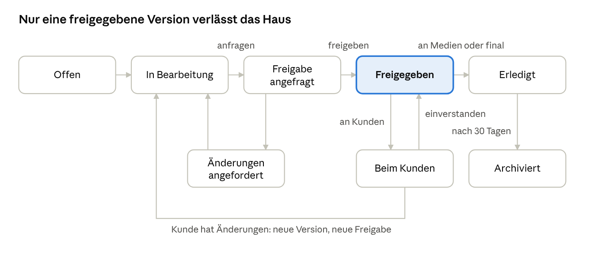

# impress Developer Briefing

> Quelle: `impress_Developer_Briefing.docx` (Stand 20.10.2026, @Lars). Dieses Dokument ist die verbindliche Bauanleitung.
> Umwandlung nach Markdown ohne inhaltliche Änderung. Redaktionell angepasst: Die Abschnitte 7.5 bis 7.10 standen im Original
> hinter Abschnitt 17 und sind hier an ihre Stelle vor Abschnitt 8 verschoben. Datenmodell, Ordnerbaum, Umgebungsvariablen,
> Projektstruktur und Beispieldateien sind als Codeblöcke gesetzt. Das Statusdiagramm liegt unter `docs/briefing/`.

Interne Presse- und Content-Plattform für Rud Pedersen Berlin · Oct 20, 2026 · @Lars

## 0. Zweck und Arbeitsregeln für Claude Code

Dieses Dokument ist die vollständige Bauanleitung für impress, eine interne Arbeitsplattform für Presse- und Content-Arbeit von Rud Pedersen Berlin. Claude Code baut danach ohne Rückfragen. Alle fachlichen Entscheidungen sind getroffen und stehen hier.

Arbeitsregeln:

1.  Baue in der Reihenfolge der Bauphasen (Abschnitt 12). Eine Phase gilt erst als fertig, wenn alle ihre Abnahmekriterien erfüllt und durch automatisierte Tests abgedeckt sind.

2.  Wo dieses Dokument einen Standardwert nennt, nimm ihn. Wo es etwas nicht regelt, triff die einfachste Entscheidung, die zu den Grundsätzen (Abschnitt 2) passt, und halte sie in DECISIONS.md im Repository fest (Datum, Frage, Entscheidung, Begründung in einem Satz).

3.  Alle Oberflächentexte sind Deutsch. Lege sie zentral ab (eine Datei pro Bereich), damit später Englisch ergänzt werden kann.

4.  Externe Dienste (Microsoft-Login, SharePoint, Claude API, Push) laufen über Adapter mit einer lokalen Ersatzimplementierung. Die Plattform muss lokal vollständig ohne Zugangsdaten zu RP-Systemen laufen und testbar sein.

5.  Die Beispieldaten in Abschnitt 13 sind erfunden. Sie dienen nur dem Bau und den Tests und werden vor dem Livebetrieb gelöscht.

6.  Nach jeder Phase: README aktualisieren, Migrationen und Seeds lauffähig halten, eine kurze Notiz in CHANGELOG.md.

7.  Schreibe nie Zugangsdaten, Schlüssel oder echte Personendaten in den Code oder in Logs.

## 1. Ausgangslage, Ziel, Erfolgskriterien

impress bündelt die tägliche Medienarbeit des Teams an einem Ort: Aufträge von Kunden werden Aufgaben, Texte werden auf der Plattform geschrieben, geprüft und im Vier-Augen-Prinzip freigegeben, und Pressespiegel und Journalistenkontakte sind direkt mit dem jeweiligen Kunden verknüpft.

Heute verteilt sich diese Arbeit auf Word-Dateien im SharePoint, Teams-Nachrichten, Excel-Listen und private Handys. Prioritäten sind nicht sichtbar, Freigaben laufen über Zuruf, Kontakte zu Journalisten liegen bei einzelnen Personen, und Wissen über Kunden wird bei jedem Text neu zusammengesucht.

Der Unterschied zu Meltwater und ähnlichen Diensten: impress kennt die Kunden, kennt die verifizierten Kontakte von RP und verbindet beides mit der täglichen Berichterstattung. Monitoring liefert Meltwater, impress macht daraus Arbeit.

Rahmen für die erste Version:

- Nutzer: nur Rud Pedersen Berlin, nur intern, kein Zugang für Kunden.

- Sprache: Deutsch.

- Startkunden: Covenant, Ground A, Rafael, SAFENET. Capital.com folgt mit eigenem Workflow in einer späteren Ausbaustufe.

- Arbeitsname: impress.

- Gebaut wird mit Claude Code, danach übernimmt ein Entwickler Hosting und Betrieb (Abschnitt 16).

Erfolg nach drei Monaten Livebetrieb:

1.  Die laufenden Medienmandate der Startkunden werden vollständig über impress gesteuert: jede Aufgabe, jeder Text, jede Freigabe.

2.  Der Pressespiegel-Dienst läuft jeden Werktag über impress.

3.  Die bisherigen Kontaktlisten sind importiert, und die Zahl der verifizierten Kontakte wächst messbar (Kennzahl im Admin-Bereich).

4.  Push-Nachrichten werden ernst genommen, weil sie selten sind: im Schnitt höchstens drei pro Person und Tag (Kennzahl im Admin-Bereich).

5.  Das Team kann benennen, welche weiteren Prozesse als Nächstes auf impress wandern sollen.

## 2. Grundsätze

Diese Regeln gelten für jede Funktion. Bei Zweifeln entscheiden sie.

1.  Der Mensch schreibt, die KI hilft. impress erzeugt nie eine komplette Pressemitteilung oder einen kompletten Text. Die KI liefert Hinweise, Bausteine (Headline, Zitat) und Vorschläge.

2.  KI-Inhalte sind immer erkennbar. Jeder von der KI erzeugte Text ist farbig markiert und trägt das Label KI, bis ein Mensch ihn ausdrücklich annimmt. Erst dann gehört er dem Autor.

3.  Vier Augen sehen jeden Text, der das Haus verlässt. Niemand gibt seinen eigenen Text frei, auch kein CVD (Ausnahme nur über ein ausdrücklich vergebenes Recht, Abschnitt 3).

4.  Nichts geht automatisch nach draußen. Weder an Kunden noch an Journalisten.

5.  Der Kunde ist ein Filter, kein eigener Ort. Über eine Kundenauswahl im Kopf der Seite filtern Dashboard, Redaktion, Pressespiegel und Journo Hub auf einen Kunden. Die Auswahl bleibt beim Wechsel zwischen Bereichen erhalten.

6.  Ein Arbeitsablauf ohne Brüche. Wer an einem Text arbeitet, sieht daneben, was er braucht (Prüfung, passende Journalisten, Kundenwissen), ohne die Seite zu verlassen.

7.  Push nur, wenn es brennt. Alles andere erscheint in der Benachrichtigungsliste der Plattform, nicht auf dem Handy.

8.  Herkunft ist immer sichtbar. Bei Kontakten, Kundenwissen und Texten sieht man, wer etwas angelegt, verifiziert, geändert oder freigegeben hat, und ob es von der KI, aus dem Pressespiegel, aus einem Import oder von einem Menschen stammt.

9.  So wenig Daten wie nötig. Keine Verträge, keine Passwörter, keine Volltexte fremder Artikel auf Dauer.

## 3. Nutzer, Rollen, Rechte

Rechte setzen sich aus drei Ebenen zusammen: einer Grundrolle, Zuordnungen pro Kunde und einzelnen Zusatzrechten pro Person. Nur CVDs vergeben Rechte. Jede Rechteänderung wird protokolliert.

### 3.1 Grundrollen

- Redakteur: Standardrolle für alle Beraterinnen und Berater.

- CVD (Chef vom Dienst): sieht alles, gibt alles frei, verwaltet Nutzer, Rechte, Kunden und Dienstplan.

- Admin: zusätzliches Merkmal für technische Einstellungen (Integrationen, KI-Einstellungen, Kennzahlen). Wird zusätzlich zu einer Grundrolle vergeben.

### 3.2 Zuordnung pro Kunde

- Kunden-Lead: ist für einen Kunden verantwortlich, pflegt dessen Profil, darf für diesen Kunden Aufgaben für andere anlegen. Freigeben darf ein Kunden-Lead erst, wenn ein CVD das Freigaberecht für diesen Kunden einschaltet.

- Team: Redakteure, die einem Kunden zugeordnet sind. Alle Nutzer sehen alle Kunden, die Zuordnung steuert nur Vorschläge (Owner-Auswahl, Freigeber, Benachrichtigungen).

### 3.3 Rechtematrix

| Recht                                        | Redakteur                    | Kunden-Lead (für seinen Kunden) | CVD                    |
|----------------------------------------------|------------------------------|---------------------------------|------------------------|
| Eigene Aufgaben anlegen                      | ja                           | ja                              | ja                     |
| Aufgaben für andere anlegen                  | nein                         | ja                              | ja                     |
| Priorität manuell hochstufen                 | nein                         | nein                            | ja                     |
| Texte freigeben                              | nein                         | wenn vom CVD eingeschaltet      | ja                     |
| Eigene Texte freigeben                       | nein                         | nein                            | nein                   |
| Kundenprofil bearbeiten                      | Vorschläge machen            | ja                              | ja                     |
| Ziele, KPIs, vereinbarte Leistungen pflegen  | nein                         | nein                            | ja                     |
| Kunden anlegen, archivieren                  | nein                         | nein                            | ja                     |
| Kontakt anlegen, bearbeiten, verifizieren    | ja                           | ja                              | ja                     |
| Verifizierung entziehen, Kontakt löschen     | nein                         | nein                            | ja                     |
| Telefonnummer und Mail sehen                 | als Owner oder nach Freigabe | als Owner oder nach Freigabe    | ja, wird protokolliert |
| Pressespiegel importieren und bearbeiten     | ja                           | ja                              | ja                     |
| Dienstplan pflegen                           | nein                         | nein                            | ja                     |
| Nutzer anlegen, Rechte vergeben, Offboarding | nein                         | nein                            | ja                     |

Zusatzrechte pro Person (vom CVD vergeben, mit Datum und Vergeber protokolliert): Freigaberecht für einzelne Kunden, Aufgaben für andere anlegen, Selbstfreigabe. Die Selbstfreigabe ist standardmäßig aus, kann nicht an sich selbst vergeben werden, und jede Selbstfreigabe ist im Verlauf des Dokuments als solche markiert.

Regel für Freigaben: Ein Text braucht immer die Freigabe einer zweiten Person mit Freigaberecht für diesen Kunden. Schreibt ein CVD, gibt ein anderer CVD oder ein freigabeberechtigter Kunden-Lead frei.

### 3.4 Startnutzer

| Name             | Grundrolle | Admin | Kunden-Lead                           |
|------------------|------------|-------|---------------------------------------|
| Lars Scholtyssyk | CVD        | ja    |                                       |
| Lukas            | CVD        | ja    |                                       |
| Laura            | Redakteur  |       |                                       |
| Robin            | Redakteur  |       |                                       |
| Mika             | Redakteur  |       |                                       |
| Juliana          | Redakteur  |       |                                       |
| Hannah           | Redakteur  |       |                                       |
| Valentin Abel    | Redakteur  |       | SAFENET (Freigaberecht eingeschaltet) |

Nachnamen und Mailadressen außer bei Lars und Valentin werden beim ersten Login aus dem Microsoft-Konto übernommen. Im Seed stehen Platzhalter (vorname@example.com). Die Zuordnung eines Microsoft-Kontos zu einem angelegten Nutzer erfolgt über die Mailadresse. Wer sich ohne angelegten Nutzer anmeldet, sieht eine Seite mit dem Hinweis, sich an einen CVD zu wenden, und erhält keinen Zugriff.

## 4. Navigation und Bereiche

impress hat sechs Bereiche in einer linken Navigation und eine feste Kopfzeile. Das Dashboard ist die Startseite nach dem Login.

Kopfzeile (immer sichtbar):

- Kundenauswahl: "Alle Kunden" oder ein Kunde. Gilt für alle Bereiche, bleibt beim Wechsel erhalten, wird pro Nutzer gespeichert.

- Suche über Aufgaben, Dokumente, Kontakte und Kunden.

- Schaltfläche "Neue Aufgabe".

- Glocke mit ungelesenen Benachrichtigungen.

- Profil (eigene Einstellungen, Push einrichten, Abmelden).

Bereiche:

| Bereich       | Wofür                                                                                                                | Wer                                  |
|---------------|----------------------------------------------------------------------------------------------------------------------|--------------------------------------|
| Dashboard     | eigene Aufgaben nach Priorität, wartende Freigaben, Dienst heute, Einstieg in Redaktion und Pressespiegel, Warnungen | alle                                 |
| Redaktion     | alle Dokumente und Aufgaben, Editor, Prüfung, Freigabe, Projekte                                                     | alle                                 |
| Pressespiegel | Import, Sichtung, Relevanz pro Kunde, Aktionen, Pressespiegel-Dokument                                               | alle                                 |
| Journo Hub    | Journalisten und Medien, Kontaktanfragen, Import                                                                     | alle                                 |
| Kunden        | Kundenprofile, Onboarding, Dokumente, Leistungen, Projekte                                                           | alle sehen, Bearbeitung nach Rechten |
| Dienstplan    | Wochenansicht der Dienste                                                                                            | alle sehen, CVD pflegt               |
| Verwaltung    | Nutzer, Rechte, Offboarding, Einstellungen, Kennzahlen, Protokoll                                                    | CVD, Admin                           |

Der Journo Hub hat bewusst keinen Platz auf dem Dashboard. Journalisten erscheinen dort, wo sie gebraucht werden: neben dem Text im Editor und im Pressespiegel.

Mobil (Smartphone): Dashboard, Aufgabenliste, Benachrichtigungen, Freigaben (Dokument lesen, freigeben oder Änderungen anfordern), Kontaktanfragen beantworten und Kontakte nachschlagen. Der Editor ist auf dem Smartphone nur lesbar.

## 5. Datenmodell

Das Modell ist der verbindliche Kern. Feldnamen dürfen technisch angepasst werden, Bedeutung und Beziehungen nicht. Alle Tabellen haben id (UUID), createdAt, createdBy, updatedAt, updatedBy. Zeiten werden in UTC gespeichert und in Europe/Berlin angezeigt.

```
User
name, email, entraObjectId?, role (REDAKTEUR | CVD), isAdmin, active,
pushSubscriptions[], selectedClientId?, deactivatedAt?

PermissionGrant Zusatzrecht pro Person
userId, permission (APPROVE | CREATE_TASKS_FOR_OTHERS | SELF_APPROVE),
clientId?, grantedBy, grantedAt, revokedAt?

Client
name, shortName, industry, cluster (z.B. Defence), status (ONBOARDING | AKTIV | ARCHIVIERT),
aiAllowed (Standard true), logoFileId?, templateSettings, sharePointFolderPath

ClientMember Zuordnung Nutzer zu Kunde
clientId, userId, kind (LEAD | TEAM), canApprove (nur bei LEAD, vom CVD gesetzt)

ClientProfileSection ein Abschnitt des Kundenprofils (Abschnitt 7.7)
clientId, key, content (strukturiertes JSON), confirmedAt, confirmedBy

ProfileSuggestion KI-Vorschlag zur Profiländerung
clientId, sectionKey, proposedChange, sourceDocumentId?, sourceFileId?,
status (OFFEN | ANGENOMMEN | ABGELEHNT), decidedBy?, decidedAt?

Speaker freigegebene Sprecher des Kunden
clientId, name, function, topics[], quoteNeedsClientApproval

AgreedService vereinbarte Leistung
clientId, title, category, targetCount, periodStart, periodEnd, doneCount (berechnet)

Kpi
clientId, title, target, period, note

Project
clientId, title, kind (PRESSE_EVENT | ROUNDTABLE | KAMPAGNE | SONSTIGES),
status, startDate?, endDate?, agreedServiceId?

Task
clientId, projectId?, agreedServiceId?, title, description, category, type (DOKUMENT | AUFGABE),
ownerId, dueAt (Pflicht), embargoAt?, priorityManual (null | DRINGEND),
priority (berechnet), status, preferredApproverId?

Document 1:1 zu Task vom Typ DOKUMENT
taskId, format, title, content (Editor-JSON), lockedBy?, lockedAt?,
trackChangesOn, templateChoice (RP | KUNDE), currentVersionId

DocumentVersion
documentId, number, content, reason (STATUSWECHSEL | MANUELL | IMPORT), createdBy

Comment
documentId, anchor (Textbereich), body, threadId, resolvedAt?, resolvedBy?

Approval
documentId, versionId, requestedBy, requestedAt, claimedBy?, claimedAt?,
decision (FREIGEGEBEN | AENDERUNGEN | ZURUECKGEZOGEN), decidedBy?, decidedAt?, note,
isSelfApproval, checkRunId?

Dispatch Versand eines freigegebenen Textes
documentId, versionId, target (KUNDE | MEDIEN | INTERN), recipients, channel, sentAt, sentBy,
sharePointFileUrl?

CheckRun Prüfung (Abschnitt 7.4)
documentId, versionId, mode (SCHNELL | VOLL), strictness, scores, findings[], model, promptVersion

Finding
checkRunId, category, severity, confidence, anchor, message, reason,
status (OFFEN | ERLEDIGT | VERWORFEN), dismissReason?

DismissalRule gelernte Verwerfung pro Kunde
clientId, category, pattern, createdBy

AiInsertion KI-Baustein im Text
documentId, kind (HEADLINE | ZITAT | LEAD | SONSTIGES), status (OFFEN | ANGENOMMEN | VERWORFEN),
acceptedBy?, acceptedAt?

Media Medium
name, type (LEITMEDIUM | REGIONAL | FACH | AGENTUR | RUNDFUNK | ONLINE), desks[]

Journalist
firstName, lastName, mediaId?, desk, function, topics[], region, notes,
status (VERIFIZIERT | MANUELL | IMPORT | PRESSESPIEGEL | KI_VORSCHLAG),
source, verifiedBy?, verifiedAt?, firstContactAt?, lastActivityAt

ContactDetail Telefon, Mail, Social; getrennt gespeichert
journalistId, kind (TELEFON | MAIL | LINKEDIN | X | SONSTIGES), value, isPrimary

ContactOwner
journalistId, userId, since, relationNote?, relationQuality? (GUT | NEUTRAL | SCHWIERIG),
active (false nach Austritt des Nutzers)

ContactRequest
journalistId, requesterId, clientId, projectId?, taskId?, reason, urgency,
status (OFFEN | FREIGEGEBEN | UEBERNOMMEN | ABGELEHNT), decidedBy?, decidedAt?, decisionNote?

ContactAccessGrant Freigabe von Nummer und Mail
journalistId, userId, clientId, projectId?, grantedBy, validUntil?

RevealLog wer hat wann welche Kontaktdaten aufgedeckt
journalistId, userId, kind, at

MonitoringImport
uploadedBy, fileId, sourceType (MELTWATER_CSV | MELTWATER_XLSX | MANUELL), mappingId?, articleCount

Article
importId, publishedAt, headline, teaser, url, mediaName, mediaId?, authorName, journalistId?,
language, reach?, fullTextPasted?, fullTextExpiresAt?

ArticleRelevance
articleId, clientId, score (0 bis 100), reason, selected, selectedBy?

ArticleAction
articleId, clientId, kind (EINSCHAETZUNG | LINKEDIN_KOMMENTAR | NEWSHOOK_PITCH | KONTAKT_UEBERNEHMEN),
resultTaskId?, resultJournalistId?

ShiftType / Shift
ShiftType: name, defaultStart, defaultEnd, createsTask (z.B. Pressespiegel-Dienst)
Shift: shiftTypeId, userId, date, start, end

Notification
userId, kind, title, link, isPush, readAt?

File
storageKey, name, mimeType, size, clientId?, uploadedBy

AuditLog
actorId, action, entity, entityId, before?, after?, at
```

## 6. Workflows und Statusmodelle

Jeder Auftrag wird eine Aufgabe. Eine Aufgabe ist entweder ein Dokument (mit Text, Freigabe und Versand) oder eine einfache Aufgabe ohne Text (anrufen, Termin abstimmen).

### 6.1 Aufgabe anlegen

Formular in dieser Reihenfolge, mit der Kundenauswahl der Kopfzeile vorbelegt:

1.  Kunde (Pflicht).

2.  Kategorie (Pflicht): Medienarbeit, Digitale Kommunikation, Event, Intern.

3.  Typ: Dokument (dann Darstellungsform wählen, Abschnitt 7.3) oder einfache Aufgabe.

4.  Titel (Pflicht).

5.  Owner (Standard: ich selbst; andere nur mit Recht).

6.  Frist (Pflicht). Schnellwahl: in 2 Stunden, heute 17 Uhr, morgen 12 Uhr, in 3 Werktagen. Vorbelegt: in 3 Werktagen.

7.  Optional: Sperrfrist, Projekt, vereinbarte Leistung, bevorzugter Freigeber, Beschreibung, Anhänge.

Beim Speichern einer Dokument-Aufgabe wird ein leeres Dokument aus der Vorlage der Darstellungsform erzeugt und direkt im Editor geöffnet.

### 6.2 Priorität

Die Priorität wird aus der Frist berechnet und alle 5 Minuten neu bestimmt:

| Priorität | Regel                                                                               |
|-----------|-------------------------------------------------------------------------------------|
| Dringend  | Frist in höchstens 2 Stunden oder überschritten, oder vom CVD als dringend markiert |
| Hoch      | Frist heute                                                                         |
| Normal    | Frist in den nächsten 3 Werktagen                                                   |
| Niedrig   | Frist später                                                                        |

Nur CVDs stufen manuell auf Dringend hoch und können die Markierung wieder entfernen. Werktage: Montag bis Freitag, ohne Feiertage in Berlin. Sortierung in allen Listen: Priorität, dann Frist, dann Anlagedatum.

### 6.3 Status einer Dokument-Aufgabe

| Status                 | Bedeutung                                                    | Nächste Schritte                              |
|------------------------|--------------------------------------------------------------|-----------------------------------------------|
| Offen                  | angelegt, noch nicht begonnen                                | Owner öffnet den Editor                       |
| In Bearbeitung         | Owner schreibt                                               | Prüfung, Freigabe anfragen                    |
| Freigabe angefragt     | wartet auf zweite Person                                     | freigeben oder Änderungen anfordern           |
| Änderungen angefordert | zurück beim Owner                                            | überarbeiten, erneut anfragen                 |
| Freigegeben            | Text ist gesperrt, bereit zum Versand                        | versenden                                     |
| Beim Kunden            | an Kunden zur Abstimmung geschickt                           | Kunde einverstanden oder Kunde hat Änderungen |
| Erledigt               | an Medien oder final verschickt, im SharePoint abgelegt      | archivieren                                   |
| Archiviert             | nicht mehr in Listen, über Suche und Kundenprofil auffindbar |                                               |



*Status eines Dokuments · 8 Zustände. Diagramm als Text: Offen → In Bearbeitung → (anfragen) Freigabe angefragt → (freigeben) Freigegeben → (an Medien oder final) Erledigt → (nach 30 Tagen) Archiviert. Freigabe angefragt → Änderungen angefordert → In Bearbeitung. Freigegeben → (an Kunden) Beim Kunden → (einverstanden) Freigegeben. Beim Kunden → (Kunde hat Änderungen: neue Version, neue Freigabe) In Bearbeitung. Überschrift im Diagramm: „Nur eine freigegebene Version verlässt das Haus“.*

Jede Änderung am Text, nach einem Änderungswunsch oder einem Rückläufer vom Kunden, führt zurück in die Bearbeitung und braucht eine neue Freigabe.

Einfache Aufgaben kennen nur Offen, In Bearbeitung, Erledigt, Archiviert.

Unverrückbare Regeln:

- Ein freigegebener Text ist gesperrt. Wer ihn ändert, setzt ihn zurück auf In Bearbeitung. Die Freigabe gilt für genau die freigegebene Version.

- Freigabe anfragen ist gesperrt, solange nicht angenommene KI-Bausteine im Text stehen.

- Wurde keine Prüfung gestartet, fragt impress vor der Freigabeanfrage einmal nach ("Ohne Prüfung anfragen?"). Der Freigeber sieht, ob geprüft wurde und wie viele Hinweise offen sind.

- Archivierung erfolgt automatisch 30 Tage nach Erledigt.

### 6.4 Freigabe

1.  Owner klickt "Freigabe anfragen". Vorbelegt ist der bevorzugte Freigeber, sonst alle Freigabeberechtigten des Kunden. Eine Notiz an den Freigeber ist möglich.

2.  Alle angefragten Freigeber sehen den Text unter "Wartet auf meine Freigabe".

3.  Wer den Text öffnet, übernimmt die Prüfung ("Lukas prüft gerade"). Andere sehen das und können nur nach Bestätigung übernehmen.

4.  Der Freigeber kann direkt im Text ändern. Dann ist die Änderungsverfolgung automatisch an, und jede Änderung trägt seinen Namen.

5.  Entscheidung: Freigeben, oder Änderungen anfordern mit Pflichtkommentar.

6.  Bei Freigabe wird eine Version gespeichert, der Owner bekommt die Aufgabe "Versenden".

Eskalation bei dringenden Freigaben: nach 30 Minuten ohne Entscheidung Push an alle Freigabeberechtigten des Kunden, nach 60 Minuten an den CVD vom Dienst und, falls keiner eingetragen ist, an alle CVDs. Beide Zeiten sind in der Verwaltung einstellbar.

### 6.5 Versand und Abstimmung mit dem Kunden

impress verschickt in der ersten Version nichts selbst. "Versenden" heißt: Text exportieren oder kopieren, außerhalb verschicken, Versand in impress festhalten.

1.  Owner wählt Ziel: an Kunden zur Abstimmung, an Medien, an Kunden final, intern.

2.  impress bietet an: Word herunterladen, PDF herunterladen, Text kopieren, Mail-Entwurf öffnen (mailto mit Betreff und Text).

3.  Owner trägt Empfänger und Kanal ein und bestätigt "Versendet".

4.  Ziel Kunde zur Abstimmung: Status Beim Kunden. Kommt der Kunde mit Änderungen, lädt der Owner die Word-Datei des Kunden hoch oder ändert direkt. Es entsteht eine neue Version, Status In Bearbeitung, und es braucht eine neue interne Freigabe. Ist der Kunde einverstanden, bleibt die Freigabe gültig.

5.  Ziel Medien oder final: Status Erledigt. Die finale Version wird als Word-Datei im Kundenordner im SharePoint abgelegt (Abschnitt 9) und in das Kundenprofil übernommen.

### 6.6 Projekte

Ein Projekt bündelt mehrere Aufgaben eines Kunden, etwa einen Journalisten-Roundtable mit Konzept, Einladung, Agenda, Q&A und Pitch. Projekte haben Titel, Art, Zeitraum, Status und optional eine vereinbarte Leistung. Beim Anlegen eines Projekts der Art Roundtable oder Presse-Event schlägt impress die typischen Aufgaben vor (Konzept, Einladung, Agenda, Q&A, Pitch), die der Nutzer per Häkchen übernimmt. Wird ein Projekt mit vereinbarter Leistung abgeschlossen, zählt die Leistung um eins hoch.

### 6.7 Kontaktanfrage an einen Owner

1.  Wer einen Kontakt ohne Zugriff auf Nummer und Mail sieht, klickt "Kontakt anfragen": Kunde, optional Projekt oder Aufgabe, Anliegen, Dringlichkeit.

2.  Alle aktiven Owner bekommen eine Push-Nachricht und eine Benachrichtigung.

3.  Ein Owner entscheidet: Freigeben (Nummer und Mail für diesen Kunden bzw. dieses Projekt sichtbar), Selbst übernehmen (der Owner spricht den Journalisten an, impress legt ihm eine Aufgabe an), oder Ablehnen mit Begründung.

4.  Antwortet niemand, erinnert impress die Owner nach 24 Stunden einmal.

5.  CVDs sehen alle Anfragen in einer Übersicht, ohne benachrichtigt zu werden.

6.  Nach erfolgreichem Kontakt kann sich der Anfragende selbst als Owner eintragen. Ein Kontakt hat höchstens 3 aktive Owner. Ein vierter braucht die Zustimmung eines CVD.

### 6.8 Neuen Kunden aufnehmen

1.  CVD legt den Kunden an (Name, Kurzname, Branche, Cluster, Kunden-Lead, Logo) und lädt vorhandene Unterlagen hoch.

2.  Die KI liest die Unterlagen und füllt das Profil mit Vorschlägen. Jeder Vorschlag ist markiert.

3.  Der Kunden-Lead geht durch ein geführtes Onboarding: Abschnitt für Abschnitt prüft er die Vorschläge, ergänzt Fehlendes und beantwortet die offenen Fragen des Systems (Abschnitt 7.7).

4.  Der CVD trägt Ziele, KPIs und vereinbarte Leistungen ein.

5.  Sind alle Pflichtabschnitte bestätigt, schaltet der CVD den Kunden auf Aktiv. Erst dann nimmt er an der Relevanzbewertung im Pressespiegel teil.

### 6.9 Offboarding einer Person

1.  CVD startet in der Verwaltung das Offboarding.

2.  impress listet alle offenen Aufgaben und alle Kontakte, deren Owner die Person ist.

3.  Für jede Aufgabe wird ein neuer Owner gewählt. Für jeden Kontakt: Owner übertragen, Notiz hinterlassen oder als inaktiven Owner stehen lassen.

4.  Der Zugang wird gesperrt. Die Person bleibt als inaktiver Owner sichtbar, bis ein neuer Owner eingetragen ist.

5.  Offboarding kann nur abgeschlossen werden, wenn keine offenen Aufgaben mehr bei der Person liegen.

## 7. Funktionen im Detail

### 7.1 Dashboard

Das Dashboard zeigt jedem Nutzer zuerst, was er heute tun muss. Alle Blöcke folgen der Kundenauswahl.

Für alle:

- Meine Aufgaben: gruppiert nach Dringend, Heute, Demnächst. Pro Zeile Kunde, Titel, Darstellungsform, Status, Frist (relativ, etwa "in 1 Std 20 Min"). Ein Klick öffnet die Aufgabe.

- Wartet auf meine Freigabe: nur für Freigabeberechtigte, mit Wartezeit.

- Dienst heute: schmale Leiste mit den Diensten des Tages (wer ist CVD vom Dienst, wer macht den Pressespiegel). Aufklappbar zur Wochenansicht.

- Redaktion und Pressespiegel als zwei Kacheln: offene Dokumente pro Status, heutige relevante Artikel für den gewählten Kunden, jeweils mit Sprung in den Bereich.

Zusätzlich für Kunden-Leads und CVDs:

- Warnungen: Kundenprofil seit mehr als 90 Tagen nicht bestätigt, Compliance-Abschnitt älter als 365 Tage, offene Profilvorschläge, vereinbarte Leistungen im Rückstand (Beispiel: "Journalisten-Roundtable: 0 von 1 im 2. Halbjahr 2026, noch 6 Wochen"). Rückstand heißt: weniger als die Hälfte erledigt, wenn mehr als die Hälfte des Zeitraums vorbei ist, oder der Zeitraum endet in 30 Tagen und es fehlt noch etwas.

Zusätzlich für CVDs, über einen Schalter "Team-Ansicht":

- alle offenen Aufgaben nach Person, überfällige Aufgaben, Freigaben, die länger als 2 Stunden warten, offene Kontaktanfragen.

Leerer Zustand: Ein neuer Nutzer ohne Aufgaben sieht einen Hinweis mit der Schaltfläche "Neue Aufgabe" und einem Link "Push einrichten".

### 7.2 Redaktion

Die Redaktion ist die Liste aller Aufgaben und Dokumente, filterbar nach Kunde, Projekt, Owner, Status, Darstellungsform, Priorität und Zeitraum. Standardansicht: alle offenen Aufgaben, sortiert wie in 6.2. Zweite Ansicht: Tafel mit einer Spalte pro Status. Dritte Ansicht: Projekte des gewählten Kunden.

Ein Dokument öffnet den Arbeitsplatz in drei Spalten:

- links: Aufgabeninfos (Kunde, Owner, Frist, Sperrfrist, Status, Verlauf, Versionen),

- Mitte: Editor,

- rechts: umschaltbare Seitenleiste mit den Reitern Prüfung, Journalisten, Kundenwissen, Kommentare.

Der Reiter Kundenwissen zeigt Kernbotschaften, Sprecher, Factsheet, aktuelles Q&A und die letzten fünf finalen Texte des Kunden. Einzelne Fakten oder Boilerplate lassen sich per Klick an der Cursorposition einfügen. Das ist eingefügtes Kundenwissen, kein KI-Text, und wird deshalb nicht als KI markiert.

### 7.3 Editor und Darstellungsformen

Der Editor arbeitet wie das Redaktionssystem einer Zeitung: Zuerst wird die Darstellungsform gewählt, dann gibt die Vorlage die Bausteine vor. Gebaut wird er auf Basis von ProseMirror (TipTap, nur Open-Source-Erweiterungen).

Funktionen:

- Bausteine als eigene Blöcke (etwa Headline, Lead, Zitat mit Sprecher), Fließtext mit Fett, Kursiv nur als Textauszeichnung, Listen, Links, Zwischenüberschriften, Tabellen einfach.

- Zeichenzähler und Zeilenzähler unten.

- Bearbeitungssperre statt gleichzeitiger Bearbeitung: Wer schreibt, sperrt das Dokument. Andere sehen "Laura bearbeitet gerade" und lesen mit. Sie können die Bearbeitung anfordern. Die Sperre fällt nach 10 Minuten ohne Eingabe oder beim Schließen.

- Änderungsverfolgung: einschaltbar, automatisch an, sobald jemand anderes als der Owner ändert. Einfügungen und Löschungen sind farbig, tragen Name und Zeit, und lassen sich einzeln oder alle annehmen oder ablehnen. Umsetzung als eigene Markierungen in ProseMirror.

- Kommentare an markierten Textstellen, mit Antworten und "erledigt".

- Versionen: automatisch bei jedem Statuswechsel, zusätzlich manuell. Zwei Versionen lassen sich nebeneinander mit markierten Unterschieden vergleichen.

- Word-Import: Eine .docx-Datei wird in das Dokument übernommen (Text, Absätze, Fett, Listen, Überschriften). Nutzbar beim Anlegen und für Rückläufer vom Kunden.

- Export als Word und PDF, wahlweise mit RP-Vorlage oder Kundenvorlage. Exportiert wird immer die saubere Fassung ohne Kommentare und Änderungsmarkierungen.

- Automatische Speicherung alle 5 Sekunden nach der letzten Eingabe.

Darstellungsformen und ihre Pflichtbausteine (Grundlage für Vorlage und Strukturprüfung):

| Darstellungsform   | Bausteine (Pflicht fett)                                                                                                                                       | Strukturregeln                                                                                                                            |
|--------------------|----------------------------------------------------------------------------------------------------------------------------------------------------------------|-------------------------------------------------------------------------------------------------------------------------------------------|
| Pressemitteilung   | Dachzeile, **Headline**, Subheadline, **Ortsmarke und Datum**, **Lead**, **Haupttext**, **Zitat mit Sprecher**, **Boilerplate**, **Pressekontakt**, Sperrfrist | Lead beantwortet Wer, Was, Wann, Wo; mindestens eine Zahl; erstes Zitat innerhalb der ersten 1.500 Zeichen; Länge 2.000 bis 4.500 Zeichen |
| Statement          | **Sprecher**, **Anlass**, **Text**                                                                                                                             | höchstens 1.200 Zeichen; Sprecher steht in der Sprecherliste                                                                              |
| Q&A                | **Stand (Datum)**, **Verwendung (intern oder extern)**, **Fragen und Antworten**                                                                               | jede Frage hat eine Antwort                                                                                                               |
| Medien-Pitch       | **Betreff**, **Aufhänger**, **Angebot** (Interview, Exklusivinfo, Hintergrund), **Ansprechpartner**                                                            | höchstens 1.500 Zeichen                                                                                                                   |
| Briefing           | **Anlass**, **Hintergrund**, Teilnehmer, **Kernbotschaften**, Fragen                                                                                           |                                                                                                                                           |
| Konzept            | **Ziel**, **Zielgruppe**, **Maßnahmen**, Zeitplan, Verantwortliche                                                                                             |                                                                                                                                           |
| Einladung          | **Anlass**, **Datum, Uhrzeit, Ort**, **Programm**, **Anmeldung**                                                                                               |                                                                                                                                           |
| Agenda             | **Titel**, **Programmpunkte mit Uhrzeit**                                                                                                                      |                                                                                                                                           |
| LinkedIn-Post      | **Text**, Hashtags, Link                                                                                                                                       | höchstens 3.000 Zeichen                                                                                                                   |
| LinkedIn-Kommentar | **Text**, **Bezugsartikel**                                                                                                                                    | höchstens 1.250 Zeichen                                                                                                                   |
| Einschätzung       | **Bezugsartikel**, **Kurzfassung**, **Bedeutung für den Kunden**, Empfehlung                                                                                   |                                                                                                                                           |
| Pressespiegel      | **Datum**, **Artikel** (je Titel, Medium, Datum, Link, Kurzfassung, Einschätzung)                                                                              | Kurzfassungen in eigenen Worten                                                                                                           |
| Liste              | **Titel**, **Einträge**                                                                                                                                        |                                                                                                                                           |

CVDs können in der Verwaltung weitere Darstellungsformen anlegen (Name, Bausteine, Pflichtfelder, Strukturregeln als Textbeschreibung für die KI).

Vorlagen für den Export:

- RP-Vorlage: RP-Logo oben rechts, Schrift TT Hoves Pro, Überschriften und Tabellenakzente im hellen RP-Blau. Schriftdatei, Logo und Farbwert werden als Dateien bzw. Einstellung in der Verwaltung hinterlegt. Bis dahin: Platzhalterlogo, Schrift Arial, Farbe als Variable RP_LIGHT_BLUE (Platzhalter \#5BB5E5).

- Kundenvorlage: Kundenlogo oben rechts, sonst wie RP-Vorlage. Fehlt ein Kundenlogo, ist die Kundenvorlage nicht wählbar.

### 7.4 Prüfung

Die Prüfung liest den Text gegen das Kundenprofil und die Regeln der Darstellungsform und gibt Hinweise. Sie schreibt den Text nicht um. Sie übernimmt die Logik des bestehenden Prüftools ABDRUCK.

Ablauf: Im Reiter Prüfung wählt der Nutzer Schnellprüfung oder Vollanalyse und startet. Die Strenge (streng, normal, locker) ist pro Kunde eingestellt und hier nur sichtbar.

| Prüfschritt                  | Schnell | Voll | Grundlage                                                           |
|------------------------------|---------|------|---------------------------------------------------------------------|
| Struktur und Vollständigkeit | ja      | ja   | Bausteine und Regeln der Darstellungsform; regelbasiert, ohne KI    |
| Compliance                   | ja      | ja   | Compliance-Abschnitt des Profils                                    |
| Faktentreue                  | ja      | ja   | Factsheet, frühere finale Texte                                     |
| Styleguide und Schreibweisen |         | ja   | Styleguide-Abschnitt                                                |
| Tone of Voice                |         | ja   | Tone of Voice und Referenztexte des Kunden                          |
| Medienresonanz               |         | ja   | Nachrichtenwert, Aktualität, Redaktionstauglichkeit                 |
| Mögliche Erweiterungen       |         | ja   | passende Fakten und Zitate aus dem Profil                           |
| Distribution                 |         | ja   | passende Medien und Ressorts, verknüpft mit dem Reiter Journalisten |

Ergebnis:

- Oben zwei Werte: Konformität (0 bis 100) und Medienresonanz (0 bis 100, nur Vollanalyse). Kein Gesamturteil und keine Begriffe wie "freigegeben", die eine Entscheidung vorwegnehmen.

- Oben außerdem Warnungen zum Profil: "Compliance-Regeln sind 14 Monate alt", "Kein Factsheet hinterlegt".

- Darunter Hinweise, gruppiert nach Prüfschritt. Jeder Hinweis: Fundstelle im Text (Klick springt hin und markiert), Schweregrad (kritisch, wichtig, Hinweis), Sicherheit (hoch, mittel, niedrig), Begründung in einem Satz.

- Aktionen pro Hinweis: "Erledigt" (Nutzer hat selbst geändert) oder "Verwerfen" mit optionalem Grund. Mit "Für diesen Kunden nicht mehr anzeigen" entsteht eine Verwerfungsregel, die künftige gleichartige Hinweise unterdrückt. Regeln sind im Kundenprofil einsehbar und löschbar.

- Bei Hinweisen der Art "Zitat fehlt" oder "Headline erklärt den Inhalt nicht" bietet impress an, einen KI-Baustein zu erzeugen (Abschnitt 8.2).

Live-Hinweise beim Schreiben: Die regelbasierte Strukturprüfung läuft ohne KI fortlaufend mit und zeigt dezente Hinweise am Rand ("Ortsmarke fehlt", "noch kein Zitat nach 1.500 Zeichen"). Live-Hinweise mit KI gehören zur späteren Ausbaustufe.

Aktualität: Liegt das im Text beschriebene Ereignis mehr als 14 Tage zurück, meldet die Medienresonanz einen wichtigen Hinweis zur Aktualität.

### 7.5 Journo Hub

Der Journo Hub ist das Kontaktverzeichnis von RP. Sein Wert liegt in verifizierten Kontakten mit bekanntem Owner, nicht in Masse.

Liste: Name, Medium, Ressort, Themen, Status-Label, Owner, zuletzt geschrieben (aus dem Pressespiegel). Filter nach Medium, Medientyp, Ressort, Thema, Status, Owner. Telefonnummer und Mail sind in der Liste immer verdeckt.

Status-Labels, gut unterscheidbar in Farbe und Wort:

| Label          | Bedeutung                                                 | entsteht durch                   |
|----------------|-----------------------------------------------------------|----------------------------------|
| Verifiziert RP | persönlich bekannter Kontakt mit vollständigen Daten      | Verifizierung durch einen Nutzer |
| Manuell        | von Hand angelegt, noch nicht verifiziert                 | Anlegen im Hub                   |
| Import         | aus einer Kontaktliste importiert, noch nicht verifiziert | Import                           |
| Pressespiegel  | aus einem Artikel übernommen                              | Klick im Pressespiegel           |
| KI-Vorschlag   | von der KI vorgeschlagen                                  | spätere Ausbaustufe              |

Verifizieren: Jeder Nutzer kann einen Kontakt verifizieren, wenn Telefonnummer, Mailadresse und Datum des ersten Kontakts eingetragen sind. Sonst ist die Schaltfläche gesperrt und zeigt, was fehlt. Wer verifiziert, wird mit Datum gespeichert und angezeigt. Wer verifiziert, wird automatisch Owner. CVDs können eine Verifizierung entziehen (mit Grund).

Kontaktseite:

- Stammdaten, Themen, Region, Notizen.

- Kontaktdaten verdeckt (Telefon zeigt nur die letzten 2 Ziffern). Aufdecken dürfen Owner, CVDs und Nutzer mit Freigabe für den aktuell gewählten Kunden. Jedes Aufdecken wird protokolliert.

- Owner mit "seit", optional Beziehungsnotiz und Beziehungsqualität (gut, neutral, schwierig).

- Herkunft und Verlauf: angelegt von, verifiziert von, zuletzt bearbeitet von, jeweils mit Datum.

- Artikel-Historie: alle Artikel aus dem Pressespiegel, die diesem Kontakt zugeordnet sind, neueste zuerst.

- Kontakt bei RP: Bei Kontakten ohne eigenen Owner zeigt impress unter "Wer kennt jemanden bei diesem Medium" alle verifizierten RP-Kontakte desselben Mediums und deren Owner. So lässt sich eine Vorstellung über Kollegen anfragen.

- Schaltfläche "Kontakt anfragen" (Ablauf 6.7).

Import:

- Formate: CSV, XLSX, vCard (.vcf, wie aus iCloud, Android oder Outlook exportiert).

- Schritt 1 Datei hochladen, Schritt 2 Spalten zuordnen (Zuordnung speicherbar), Schritt 3 Vorschau mit erkannten Dubletten, Schritt 4 übernehmen.

- Dubletten: gleiche Mailadresse, gleiche Telefonnummer (normalisiert nach E.164) oder gleicher Name plus gleiches Medium. Bei Dubletten wählt der Nutzer: zusammenführen, überspringen, als neu anlegen.

- Importierte Kontakte bekommen das Label Import, die importierende Person wird Owner.

Wöchentliche Pflege (Montag 6 Uhr, automatisch): impress sucht mögliche Dubletten und Kontakte ohne Aktivität seit 24 Monaten und legt den CVDs eine Liste zur Durchsicht vor. Es wird nichts automatisch zusammengeführt oder gelöscht.

Journalisten neben dem Text (Reiter Journalisten im Editor):

- Der Reiter ist immer verfügbar, auch während des Schreibens. Er zeigt passende Kontakte aus dem Hub, verifizierte zuerst.

- Grundlage der Auswahl: Themen und Ressort des Kontakts, seine Artikel-Historie, das Thema des Textes (Kunde, Titel, Inhalt) und die Zielmedien des Kunden.

- Jeder Vorschlag hat eine Begründung in einer Zeile, etwa "3 Artikel zum Thema in den letzten 60 Tagen, zuletzt am 14.10., Owner: Lukas".

- Hat der Hub keine passenden Kontakte, sagt impress das ausdrücklich. Er erfindet keine.

- Aus dem Reiter heraus: Kontakt öffnen, Kontakt anfragen, Kontakt für diesen Text vormerken. Vorgemerkte Kontakte erscheinen beim Versand an Medien als Empfängervorschlag.

- Hat der Text eine Sperrfrist, zeigt der Reiter sie oben an.

### 7.6 Pressespiegel

Der Pressespiegel-Dienst wird jeden Werktag morgens über impress erledigt: Monitoring importieren, sichten, für Kunden auswählen, daraus Arbeit machen.

Ablauf:

1.  Der Dienst ist im Dienstplan eingetragen. Zu Dienstbeginn legt impress der Person automatisch die Aufgabe "Pressespiegel \[Datum\]" an (Frist Standard 9:30 Uhr, einstellbar).

2.  Import: Die Person lädt den Meltwater-Export hoch (CSV oder XLSX). Beim ersten Mal werden die Spalten zugeordnet, die Zuordnung wird gespeichert. Gleiche Artikel (gleiche URL oder gleiche Headline plus Medium am selben Tag) werden zusammengefasst. Einzelne Artikel lassen sich auch von Hand anlegen (URL, Headline, Medium, Autor).

3.  Relevanz: impress bewertet jeden Artikel für jeden aktiven Kunden gegen dessen Profil (Themen und Suchbegriffe, Wettbewerber, Regulierung, Sprecher, Kernbotschaften). Ergebnis pro Kunde und Artikel: Wert von 0 bis 100 und eine Begründung in einem Satz. Bewertet werden Headline und Teaser, bei eingefügtem Volltext auch dieser.

4.  Sichtung: Ansicht "Heute relevant" pro Kunde mit den 10 höchsten Werten ab Wert 50, Ansicht "Alle Artikel" mit Suche. Pro Artikel: Headline, Medium, Autor, Datum, Teaser, Link, Wert, Begründung, Autor im Hub ja oder nein.

5.  Auswahl: Die Person setzt pro Kunde ein Häkchen "Aufnehmen". Nur ausgewählte Artikel gehen weiter. Der Volltext kann eingefügt werden, wenn die Person ihn über eigene Zugänge oder PMG gelesen hat. Er dient nur der Zusammenfassung und wird nach 30 Tagen gelöscht.

6.  Aktionen pro ausgewähltem Artikel und Kunde:

    - Einschätzung für den Kunden erzeugen (Darstellungsform Einschätzung),

    - LinkedIn-Kommentar erzeugen (nur sichtbar, wenn für den Kunden eine vereinbarte Leistung der Kategorie LinkedIn existiert),

    - Newshook-Pitch erzeugen (Darstellungsform Medien-Pitch, an den Autor oder das Ressort),

    - Autor in den Journo Hub übernehmen.

7.  Jede erzeugte Einschätzung, jeder Kommentar und jeder Pitch wird eine Aufgabe in der Redaktion mit KI-markiertem Entwurf. Sie durchläuft Annahme der KI-Bausteine, Freigabe und Versand wie jeder andere Text.

8.  "Pressespiegel erstellen" erzeugt pro Kunde ein Dokument der Darstellungsform Pressespiegel mit allen ausgewählten Artikeln: Titel, Medium, Datum, Link, Kurzfassung in eigenen Worten (KI-Baustein), Einschätzung. Es geht ebenfalls durch die Freigabe.

Journalisten aus dem Pressespiegel:

- Ist der Autor eines Artikels schon im Hub (gleicher Name und gleiches Medium), wird der Artikel automatisch seiner Artikel-Historie zugeordnet. Dabei entsteht kein neuer Kontakt.

- Neue Kontakte entstehen nur per Klick "In Journo Hub übernehmen" mit dem Label Pressespiegel. Der Kontakt bleibt unverifiziert, bis jemand die Pflichtangaben ergänzt und verifiziert.

Urheberrecht (verbindlich): Gespeichert werden Headline, Teaser wie geliefert, Link und Metadaten. Volltexte nur zeitlich begrenzt wie oben. Alles, was an Kunden geht, enthält Links und Zusammenfassungen in eigenen Worten, nie kopierte Absätze. Die PMG-Lizenz von RP liegt vor.

Quellen offen halten: Der Import läuft über eine Schnittstelle MonitoringSource. In der ersten Version gibt es nur den Datei-Import. Meltwater-API, RSS und Google Alerts sind spätere Adapter derselben Schnittstelle.

### 7.7 Kunden und Kundenprofil

Das Kundenprofil ist das Gedächtnis zu einem Kunden. Jede Prüfung, jede Relevanzbewertung und jeder Journalistenvorschlag greift darauf zu. Ein schwaches Profil macht alle anderen Funktionen schwach.

Abschnitte (Pflicht für den Status Aktiv fett):

| Abschnitt                     | Inhalt                                                                | gepflegt von                |
|-------------------------------|-----------------------------------------------------------------------|-----------------------------|
| **Stammdaten**                | Name, Kurzname, Branche, Cluster, Kunden-Lead, Team, Logo, KI erlaubt | CVD                         |
| **Ziele und Kernbotschaften** | Kommunikationsziele, 3 bis 5 Kernbotschaften                          | Kunden-Lead                 |
| KPIs                          | Kennzahl, Zielwert, Zeitraum                                          | CVD                         |
| **Vereinbarte Leistungen**    | Leistung, Kategorie, Anzahl, Zeitraum, Stand                          | CVD                         |
| **Sprecher**                  | Name, Funktion, Themen, Zitatfreigabe durch Kunden nötig ja oder nein | Kunden-Lead                 |
| **Themen und Suchbegriffe**   | Themen, Technologien, Suchbegriffe für das Monitoring, Regulierung    | Kunden-Lead                 |
| Wettbewerber                  | Namen, kurze Einordnung                                               | Kunden-Lead                 |
| Zielmedien                    | Medien und Ressorts, die für den Kunden zählen                        | Kunden-Lead                 |
| Tone of Voice                 | Beschreibung, Referenztexte                                           | Kunden-Lead                 |
| Styleguide und Schreibweisen  | Firmenname, Produktnamen, Schreibregeln                               | Kunden-Lead                 |
| Compliance                    | Regeln, Stand, Quelle                                                 | Kunden-Lead                 |
| Factsheet                     | Fakten mit Quelle und Datum                                           | Kunden-Lead                 |
| Q&A                           | aktuelles Q&A, Stand                                                  | Kunden-Lead                 |
| Tabuthemen                    | was nie gesagt wird                                                   | Kunden-Lead                 |
| Strategie und Ansatz          | hochgeladene Strategie- oder Konzeptpapiere                           | Kunden-Lead                 |
| Dokumente                     | hochgeladene Unterlagen und alle finalen Texte aus impress            | automatisch und Kunden-Lead |

Verträge und Honorare werden nicht gespeichert. Der Vertragsumfang ist nur über die vereinbarten Leistungen abgebildet.

Jeder Abschnitt hat ein Datum "bestätigt am" und eine Person. Nach 90 Tagen ohne Bestätigung erscheint eine Warnung für Kunden-Lead und CVDs, der Compliance-Abschnitt wird nach 365 Tagen rot.

Onboarding-Interview: Beim Aufnehmen eines Kunden (6.8) führt impress den Kunden-Lead durch die Abschnitte. Zu jedem Abschnitt zeigt es die Vorschläge aus den hochgeladenen Unterlagen und stellt Fragen zu Lücken, zum Beispiel: "Wer darf für den Kunden zitiert werden?", "Welche Medien sind in diesem Jahr am wichtigsten?", "Gibt es Themen, zu denen der Kunde sich nicht äußert?". Antworten werden in den Abschnitt übernommen. Das Interview lässt sich unterbrechen und fortsetzen.

Lernendes Profil: Wird ein Text erledigt oder ein Dokument hochgeladen, prüft die KI, ob sich daraus neue Fakten, Zitate oder Botschaften ergeben. Sie legt Vorschläge an ("Neue Zahl: 450 Arbeitsplätze am Standort, aus PM vom 12.10."). Der Kunden-Lead oder ein CVD nimmt an oder lehnt ab. Ohne Annahme ändert sich das Profil nicht.

KI erlaubt: Schalter pro Kunde, Standard an. Ist er aus, sind für diesen Kunden alle KI-Funktionen gesperrt (Prüfung nur regelbasiert, keine Bausteine, keine Relevanzbewertung). Der Schalter ist eine Vorsorge, falls ein Kunde das verlangt.

### 7.8 Dienstplan

Wochenansicht mit einer Zeile pro Diensttyp und einer Spalte pro Tag. CVDs tragen Personen ein, auch für mehrere Wochen im Voraus, und können eine Woche kopieren.

Diensttypen zum Start (in der Verwaltung erweiterbar):

- CVD vom Dienst (werktags 8 bis 18 Uhr),

- Pressespiegel-Dienst (werktags 7 bis 10 Uhr, legt automatisch die Pressespiegel-Aufgabe an),

- Wochenenddienst (Samstag und Sonntag).

Der Dienstplan ist unabhängig vom Outlook-Kalender. Wer als CVD vom Dienst eingetragen ist, bekommt die Eskalation nach 60 Minuten (6.4).

### 7.9 Benachrichtigungen

Alles erscheint in der Glocke. Nur wenige Ereignisse lösen zusätzlich eine Push-Nachricht aus.

| Ereignis                                         | Glocke | Push              | an                            |
|--------------------------------------------------|--------|-------------------|-------------------------------|
| Aufgabe wird mir zugewiesen                      | ja     | nur wenn Dringend | Owner                         |
| Meine Aufgabe wird Dringend                      | ja     | ja                | Owner                         |
| Freigabe angefragt                               | ja     | nur wenn Dringend | Freigeber                     |
| Dringende Freigabe wartet 30 bzw. 60 Minuten     | ja     | ja                | Freigeber bzw. CVD vom Dienst |
| Freigegeben oder Änderungen angefordert          | ja     | nur wenn Dringend | Owner                         |
| Kontaktanfrage an mich                           | ja     | ja                | Owner des Kontakts            |
| Antwort auf meine Kontaktanfrage                 | ja     | nein              | Anfragender                   |
| Kommentar an mich oder in meinem Text            | ja     | nein              | Owner, Erwähnte               |
| Profilwarnung, Leistung im Rückstand             | ja     | nein              | Kunden-Lead, CVDs             |
| Bearbeitung meines gesperrten Textes angefordert | ja     | nein              | wer sperrt                    |

Push-Nachrichten sind klar als impress erkennbar, nennen Kunde, Aufgabe und Frist und öffnen beim Antippen die Aufgabe. Push kommt nie über Mail oder Teams. Jede Push-Nachricht wird gezählt (Kennzahl in der Verwaltung).

### 7.10 Verwaltung

- Nutzer: anlegen, Grundrolle, Admin, Kundenzuordnungen, Zusatzrechte, sperren, Offboarding.

- Kunden: anlegen, archivieren, Freigaberecht für Kunden-Leads.

- Darstellungsformen: Bausteine, Pflichtfelder, Strukturregeln.

- Diensttypen.

- Einstellungen: Eskalationszeiten, Pressespiegel-Frist, Relevanzschwelle (Standard 50), Anzahl Top-Artikel (Standard 10), RP-Vorlage (Logo, Schrift, Farbe).

- Integrationen und KI (nur Admin): Status von Microsoft-Login, SharePoint, Claude API, Push; Modellwahl.

- Kennzahlen: aktive Nutzer pro Woche, Aufgaben pro Status, mittlere Freigabezeit, Push-Nachrichten pro Person und Tag, verifizierte Kontakte im Zeitverlauf, Pressespiegel-Dienste erledigt.

- Protokoll: Rechteänderungen, Freigaben, Selbstfreigaben, Aufdecken von Kontaktdaten, Löschungen, durchsuchbar und filterbar.

## 8. KI-Funktionen und Regeln

Alle KI-Aufrufe laufen über ein einziges Modul ai-service. Kein anderer Teil des Codes ruft die Claude API direkt auf.

### 8.1 Übersicht

| Funktion                                                                      | Eingabe                                                               | Ausgabe                         | Modell (Standard) |
|-------------------------------------------------------------------------------|-----------------------------------------------------------------------|---------------------------------|-------------------|
| Prüfung Compliance, Fakten, Stil, Tone, Resonanz, Erweiterungen, Distribution | Text, Darstellungsform, relevante Profilabschnitte, Verwerfungsregeln | Hinweise als JSON               | AI_MODEL_QUALITY  |
| Headline-Vorschläge                                                           | Text, Darstellungsform, Kernbotschaften                               | 3 Headlines                     | AI_MODEL_QUALITY  |
| Zitatvorschlag                                                                | Text, gewählter Sprecher, Kernbotschaften, frühere Zitate             | 1 Zitat                         | AI_MODEL_QUALITY  |
| Lead straffen                                                                 | Lead, Haupttext                                                       | 1 Lead                          | AI_MODEL_QUALITY  |
| Relevanzbewertung                                                             | Headline, Teaser, ggf. Volltext, kompaktes Profil je Kunde            | Wert und Begründung je Kunde    | AI_MODEL_FAST     |
| Kurzfassung Artikel                                                           | Volltext oder Teaser                                                  | 2 bis 3 Sätze in eigenen Worten | AI_MODEL_FAST     |
| Einschätzung, LinkedIn-Kommentar, Newshook-Pitch                              | Artikel, Kundenprofil                                                 | Entwurf                         | AI_MODEL_QUALITY  |
| Profil aus Unterlagen                                                         | hochgeladene Dateien                                                  | Vorschläge je Abschnitt         | AI_MODEL_QUALITY  |
| Profilvorschläge aus finalen Texten                                           | finaler Text, Profil                                                  | Vorschläge                      | AI_MODEL_FAST     |
| Onboarding-Fragen                                                             | Profil mit Lücken                                                     | Fragen                          | AI_MODEL_FAST     |
| Journalistenvorschläge im Editor                                              | Text, Kontakte mit Themen und Artikel-Historie                        | Rangfolge und Begründung        | AI_MODEL_FAST     |

Standardwerte der Umgebungsvariablen: AI_MODEL_QUALITY=claude-sonnet-5-5, AI_MODEL_FAST=claude-haiku-5-5. Beide sind in der Verwaltung änderbar.

### 8.2 KI-Bausteine im Text

- Ein KI-Baustein wird an der Cursorposition oder anstelle der Markierung eingefügt, mit hellblauem Hintergrund und dem Label KI.

- Bei Headlines wählt der Nutzer einen von 3 Vorschlägen aus einer Liste, erst dann wird eingefügt.

- Der Baustein bleibt markiert, auch wenn der Nutzer darin ändert, bis er auf "Übernehmen" klickt. "Verwerfen" entfernt ihn.

- Solange ein Baustein offen ist, ist "Freigabe anfragen" gesperrt (6.3). Angenommene Bausteine sind im Verlauf nachvollziehbar (wer, wann, welche Art).

- Entwürfe aus dem Pressespiegel (Einschätzung, Kommentar, Pitch) sind vollständig als ein Baustein markiert und brauchen dieselbe Annahme.

### 8.3 Verbindliche Regeln für alle KI-Aufrufe

1.  Prompts liegen versioniert im Repository (prompts/), eine Datei pro Funktion, mit Versionsnummer. Jede Ausgabe speichert Modell und Promptversion.

2.  Ausgaben mit Struktur kommen als JSON und werden mit Zod geprüft. Bei ungültiger Ausgabe einmal erneut versuchen, dann eine verständliche Fehlermeldung zeigen.

3.  Temperatur 0 für Prüfung und Relevanz, 0,4 für Formulierungsvorschläge.

4.  Die KI bekommt nur, was sie für die Aufgabe braucht. Telefonnummern und Mailadressen von Journalisten werden nie an die KI geschickt.

5.  Die KI erfindet keine Fakten. Prompts verlangen, nur Fakten aus Text und Profil zu verwenden und fehlende Angaben als Platzhalter in eckigen Klammern zu setzen ("\[Zahl einfügen\]").

6.  Jeder Hinweis der Prüfung braucht eine Fundstelle im Text oder den ausdrücklichen Vermerk "betrifft den ganzen Text".

7.  Ist für einen Kunden "KI erlaubt" aus, verweigert ai-service jeden Aufruf mit Bezug zu diesem Kunden.

8.  Schreibstil aller KI-Texte: klar, konkret, ohne Floskeln, ohne Gedankenstriche als Stilmittel, wie ein Redakteur einer deutschen Tageszeitung schreiben würde. Diese Vorgabe steht in jedem Formulierungs-Prompt.

9.  Fällt die Claude API aus, funktioniert impress weiter, nur ohne KI-Funktionen. Die Oberfläche zeigt das an.

10. Für Tests gibt es einen Ersatz-Adapter, der feste Beispielantworten liefert.

## 9. SharePoint-Ordnerstruktur

Jeder Kunde bekommt dieselbe Ordnerstruktur. impress legt sie beim Anlegen des Kunden automatisch an und legt dort nur finale, freigegebene Texte ab. Entwürfe bleiben in impress.

```
impress/
Kunden/
<Kurzname des Kunden>/
01_Kundenprofil/
Strategie_und_Ansatz/
Styleguide_und_Compliance/
Factsheets/
QA/
02_Pressemitteilungen/<JJJJ>/
03_Statements/<JJJJ>/
04_Medienansprache/<JJJJ>/
05_Social_Media/<JJJJ>/
06_Pressespiegel_und_Einschaetzungen/<JJJJ>/<MM>/
07_Projekte/<JJJJ-MM>_<Projekttitel>/
08_Briefings_und_Konzepte/<JJJJ>/
99_Archiv/
```

Zuordnung der Darstellungsformen:

| Darstellungsform                  | Ordner                               |
|-----------------------------------|--------------------------------------|
| Pressemitteilung                  | 02_Pressemitteilungen                |
| Statement                         | 03_Statements                        |
| Medien-Pitch, Einladung an Medien | 04_Medienansprache                   |
| LinkedIn-Post, LinkedIn-Kommentar | 05_Social_Media                      |
| Pressespiegel, Einschätzung       | 06_Pressespiegel_und_Einschaetzungen |
| alles mit Projekt                 | 07_Projekte/\<Projekt\>              |
| Q&A                               | 01_Kundenprofil/QA                   |
| Briefing, Konzept, Agenda, Liste  | 08_Briefings_und_Konzepte            |

Dateinamen: JJJJ-MM-TT\_\<Kurzname\>\_\<Darstellungsform\>\_\<Titel\>\_v\<Version\>.docx, Titel auf 60 Zeichen gekürzt, Leerzeichen als Unterstrich, keine Sonderzeichen außer Bindestrich und Unterstrich. Beispiel: 2026-10-20_Covenant_Pressemitteilung_Standort_Sachsen_v3.docx.

Hochgeladene Unterlagen im Kundenprofil werden zusätzlich in 01_Kundenprofil im passenden Unterordner abgelegt. Der Wurzelpfad (Site und Bibliothek) wird in der Verwaltung eingestellt. Lokal schreibt der Ersatz-Adapter in ./storage/sharepoint-mock/ mit derselben Struktur.

## 10. Technik, Stack, Integrationen

impress ist eine Web-App mit installierbarer PWA, einem Server und einer Datenbank, betrieben in Microsoft Azure in der EU. Verwende jeweils die aktuelle stabile Version.

### 10.1 Stack

| Bereich         | Wahl                                                                                                                                     |
|-----------------|------------------------------------------------------------------------------------------------------------------------------------------|
| Sprache         | TypeScript, strikt                                                                                                                       |
| Web und Server  | Next.js (App Router), Server Actions und Route Handlers                                                                                  |
| Oberfläche      | React, Tailwind CSS, shadcn/ui                                                                                                           |
| Datenbank       | PostgreSQL, Zugriff über Prisma, Migrationen im Repository                                                                               |
| Hintergrundjobs | pg-boss (Priorität neu berechnen, Eskalation, Erinnerungen, Pressespiegel-Aufgabe, wöchentliche Pflege, Volltexte löschen, Archivierung) |
| Editor          | TipTap mit ProseMirror, nur Open-Source-Erweiterungen; Änderungsverfolgung und Kommentaranker als eigene Erweiterungen                   |
| Word-Import     | mammoth                                                                                                                                  |
| Word-Export     | docx (npm)                                                                                                                               |
| PDF-Export      | HTML-Vorlage, gerendert mit Playwright (Chromium)                                                                                        |
| Kontaktimport   | papaparse (CSV), SheetJS (XLSX), vcard-Parser; Telefonnummern mit libphonenumber-js                                                      |
| Login           | Auth.js mit Microsoft Entra ID; lokal ein Entwickler-Login mit Auswahl der Seed-Nutzer, nur bei NODE_ENV=development                     |
| SharePoint      | Microsoft Graph                                                                                                                          |
| KI              | Anthropic SDK (Claude API)                                                                                                               |
| Push            | Web Push mit VAPID (Bibliothek web-push), Service Worker, Web App Manifest                                                               |
| Dateien         | Azure Blob Storage, lokal Dateisystem, über eine gemeinsame Schnittstelle                                                                |
| Validierung     | Zod                                                                                                                                      |
| Tests           | Vitest (Einheit, Integration), Playwright (Ende zu Ende)                                                                                 |
| Lokal           | Docker Compose (App, PostgreSQL)                                                                                                         |

### 10.2 Adapter

Jeder externe Dienst hat eine Schnittstelle, eine echte Implementierung und einen Ersatz für lokal und Tests. Umschalten per Umgebungsvariable.

| Schnittstelle    | Echt                                  | Ersatz                                                       |
|------------------|---------------------------------------|--------------------------------------------------------------|
| AuthProvider     | Entra ID                              | Entwickler-Login mit Seed-Nutzern                            |
| DocumentStore    | SharePoint über Graph                 | Ordner ./storage/sharepoint-mock/                            |
| FileStorage      | Azure Blob                            | Ordner ./storage/files/                                      |
| AiProvider       | Claude API                            | feste Beispielantworten aus fixtures/ai/                     |
| PushSender       | Web Push                              | Eintrag in der Benachrichtigungstabelle plus Konsolenausgabe |
| MonitoringSource | Datei-Import (Meltwater CSV und XLSX) | dieselbe, mit Beispieldatei                                  |

### 10.3 Push und PWA

- impress ist als PWA installierbar (Desktop über Chrome oder Edge, Android, iOS ab 16.4 über "Zum Home-Bildschirm"). Push funktioniert auf iOS nur in der installierten App.

- Unter Profil führt "Push einrichten" durch Installation und Erlaubnis, je nach Gerät mit passender Anleitung, und schickt eine Testnachricht.

- Ein Nutzer kann mehrere Geräte registrieren und einzeln entfernen.

### 10.4 Umgebungsvariablen

```bash
DATABASE_URL
AUTH_SECRET
AUTH_PROVIDER=dev | entra
ENTRA_CLIENT_ID, ENTRA_CLIENT_SECRET, ENTRA_TENANT_ID
DOCUMENT_STORE=mock | sharepoint
SHAREPOINT_SITE_ID, SHAREPOINT_DRIVE_ID, SHAREPOINT_ROOT_PATH=impress/Kunden
FILE_STORAGE=local | azure
AZURE_STORAGE_CONNECTION_STRING, AZURE_STORAGE_CONTAINER
AI_PROVIDER=mock | anthropic
ANTHROPIC_API_KEY
AI_MODEL_QUALITY=claude-sonnet-5-5
AI_MODEL_FAST=claude-haiku-5-5
PUSH_PROVIDER=mock | webpush
VAPID_PUBLIC_KEY, VAPID_PRIVATE_KEY, VAPID_SUBJECT
APP_BASE_URL
TZ=Europe/Berlin
```

Eine .env.example mit allen Variablen und lokalen Standardwerten liegt im Repository. Mit AUTH_PROVIDER=dev und allen Adaptern auf mock startet impress ohne jede Zugangsdaten.

### 10.5 Projektstruktur

```
/app Seiten und Route Handlers
/components Oberfläche, nach Bereich gegliedert
/lib/domain Geschäftslogik je Bereich (tasks, documents, approvals, journo, monitoring, clients, shifts, notifications, permissions)
/lib/adapters Schnittstellen und Implementierungen
/lib/ai ai-service, Schemas
/prompts versionierte Prompts
/jobs Hintergrundjobs
/prisma Schema, Migrationen, Seed
/fixtures Beispieldateien und KI-Beispielantworten
/tests Vitest und Playwright
/i18n Oberflächentexte Deutsch
```

Rechteprüfung liegt ausschließlich serverseitig in /lib/domain/permissions. Jede Server Action und jeder Route Handler ruft sie auf. Die Oberfläche blendet nur aus, sie schützt nicht.

### 10.6 Leistung und Qualität

- Dashboard lädt in unter 1,5 Sekunden bei 500 offenen Aufgaben.

- Relevanzbewertung von 300 Artikeln für 4 Kunden in unter 5 Minuten, in Paketen und parallel, mit Fortschrittsanzeige.

- Barrierearm: Tastaturbedienung, sichtbarer Fokus, Kontraste nach WCAG AA.

- Hell- und Dunkelmodus nach Systemeinstellung.

## 11. Datenschutz und Sicherheit

impress speichert vertrauliche Kundenunterlagen, teils von Rüstungsunternehmen, und personenbezogene Daten von Journalisten. Beides wird technisch abgesichert, bevor die Plattform live geht.

Journalistendaten (DSGVO):

- Rechtsgrundlage ist das berechtigte Interesse an beruflicher Pressearbeit. Die Information der Betroffenen und das Verzeichnis der Verarbeitung regelt RP organisatorisch mit seiner Datenschutzverantwortung. impress liefert die Funktionen dafür.

- Auskunft: Für jeden Kontakt lässt sich ein Export aller gespeicherten Daten als PDF und JSON erzeugen (nur CVD).

- Löschen: CVDs löschen Kontakte endgültig, inklusive Kontaktdaten, Owner, Anfragen und Zuordnung in der Artikel-Historie. Die Löschung wird ohne personenbezogene Inhalte protokolliert.

- Prüfliste: Kontakte ohne Aktivität seit 24 Monaten erscheinen in der wöchentlichen Pflege (7.5).

- Kontaktdaten liegen in einer eigenen Tabelle, sind verdeckt, und jedes Aufdecken wird protokolliert.

- Keine Kontaktdaten an die KI (8.3).

Kundenunterlagen:

- Hosting und Datenbank in Azure in der EU, Dateien verschlüsselt gespeichert, Verbindungen nur über TLS.

- KI-Aufrufe über die Claude API unter dem Vertrag von RP mit Anthropic. Schalter "KI erlaubt" pro Kunde (7.7).

- Keine Verträge, keine Honorare, keine Passwörter in impress.

Zugang und Protokoll:

- Login nur über Microsoft Entra ID der RP. Sitzungen laufen nach 12 Stunden ab.

- Rechte nur serverseitig geprüft (10.5).

- Protokoll aller sicherheitsrelevanten Aktionen (7.10). Einträge können nicht bearbeitet werden.

- Gesperrte Nutzer verlieren sofort den Zugang, auch laufende Sitzungen.

Betrieb (Vorgaben für den Hosting-Entwickler, Abschnitt 16): tägliche Sicherung der Datenbank und der Dateien, 30 Tage aufbewahrt, Wiederherstellung einmal getestet vor Livegang; Abhängigkeiten monatlich aktualisiert; Logs ohne Inhalte von Texten und ohne Kontaktdaten.

## 12. Bauphasen mit Abnahmekriterien

Sieben Phasen, jede baut auf der vorigen auf. Nach Phase 2 ist impress für den Redaktionsalltag nutzbar, nach Phase 6 vollständig für den Livegang bereit.

### Phase 0: Grundgerüst

- [ ] Repository mit Projektstruktur (10.5), Docker Compose, .env.example, README mit Startanleitung in drei Befehlen.

- [ ] Prisma-Schema für das gesamte Datenmodell (Abschnitt 5), erste Migration, Seed mit Nutzern und Kunden (Abschnitt 13).

- [ ] Entwickler-Login mit Auswahl der Seed-Nutzer, Grundlayout mit Navigation und Kopfzeile, Kundenauswahl funktioniert und bleibt gespeichert.

- [ ] Alle Adapter mit Ersatzimplementierung, umschaltbar per Umgebungsvariable.

- [ ] Tests laufen mit einem Befehl, ein Beispieltest pro Testart.

### Phase 1: Aufgaben, Dashboard, Rechte, Dienstplan

- [ ] Rechteprüfung serverseitig für alle Rechte aus 3.3, mit Tests für jede Zeile der Matrix.

- [ ] Nutzerverwaltung mit Zusatzrechten und Kundenzuordnungen, Protokoll der Rechteänderungen.

- [ ] Kunden mit Stammdaten anlegen und archivieren.

- [ ] Aufgaben anlegen (6.1), Priorität berechnet und alle 5 Minuten aktualisiert (6.2), CVD-Hochstufung.

- [ ] Statusmodell für einfache Aufgaben vollständig.

- [ ] Dashboard (7.1) mit allen Blöcken außer Pressespiegel-Kachel, Team-Ansicht für CVDs.

- [ ] Redaktion als Liste und Tafel mit allen Filtern.

- [ ] Dienstplan (7.8) mit Diensttypen, Wochenansicht, Kopieren, Leiste auf dem Dashboard.

- [ ] Glocke mit allen Ereignissen aus 7.9, die in dieser Phase schon entstehen.

### Phase 2: Redaktion, Freigabe, Versand

- [ ] Editor mit allen Darstellungsformen aus 7.3, Vorlagen mit Bausteinen, Zeichenzähler, automatischer Speicherung.

- [ ] Bearbeitungssperre mit Übernahme-Anfrage und Ablauf nach 10 Minuten.

- [ ] Änderungsverfolgung mit Name und Zeit, einzeln und gesamt annehmen und ablehnen, automatisch an bei fremder Bearbeitung.

- [ ] Kommentare mit Antworten und erledigt.

- [ ] Versionen und Versionsvergleich.

- [ ] Vollständiges Statusmodell für Dokumente (6.3) inklusive Sperre nach Freigabe und Rücksetzen bei Änderung.

- [ ] Freigabe (6.4) inklusive Übernahme durch einen Freigeber, Pflichtkommentar bei Änderungswunsch, Verbot der Selbstfreigabe, Zusatzrecht Selbstfreigabe mit Markierung.

- [ ] Versand und Kundenabstimmung (6.5) inklusive Word-Rückläufer.

- [ ] Word-Import, Export Word und PDF mit RP- und Kundenvorlage, saubere Fassung.

- [ ] Ablage im SharePoint-Ersatz mit Ordnerstruktur und Dateinamen aus Abschnitt 9, Ordner werden beim Anlegen eines Kunden erzeugt.

- [ ] Projekte (6.6) mit Aufgabenvorschlägen und Zählung der vereinbarten Leistung.

- [ ] Ende-zu-Ende-Test: Redakteurin legt PM an, schreibt, fragt Freigabe an, CVD ändert mit Änderungsverfolgung und gibt frei, Redakteurin versendet an Kunden, lädt Rückläufer hoch, zweite Freigabe, Versand an Medien, Datei liegt im richtigen Ordner.

### Phase 3: Kundenprofil, Prüfung, KI-Bausteine

- [ ] Alle Profilabschnitte aus 7.7 mit "bestätigt am", Warnungen nach 90 und 365 Tagen.

- [ ] Onboarding mit KI-Vorschlägen aus Unterlagen und Fragen zu Lücken, unterbrechbar.

- [ ] Statuswechsel Onboarding zu Aktiv nur mit allen Pflichtabschnitten.

- [ ] Vereinbarte Leistungen und KPIs, Rückstandswarnung auf dem Dashboard.

- [ ] Lernendes Profil mit Vorschlagsliste, Annahme und Ablehnung.

- [ ] Prüfung (7.4) in beiden Modi, alle Prüfschritte, Werte, Profilwarnungen, Fundstellen, Erledigt und Verwerfen, Verwerfungsregeln pro Kunde.

- [ ] Regelbasierte Live-Hinweise beim Schreiben.

- [ ] KI-Bausteine (8.2) mit Markierung, Annahme, Sperre der Freigabeanfrage.

- [ ] Reiter Kundenwissen mit Einfügen von Fakten und Boilerplate.

- [ ] Schalter "KI erlaubt" sperrt alle KI-Funktionen für den Kunden.

- [ ] Alle KI-Aufrufe über ai-service mit versionierten Prompts, Zod-Prüfung und Ersatz-Adapter.

### Phase 4: Journo Hub

- [ ] Medien und Kontakte mit allen Feldern, Status-Labels, Liste mit Filtern.

- [ ] Verifizierung mit Pflichtangaben, Entzug durch CVD.

- [ ] Owner bis 3, vierter nur mit CVD-Zustimmung, inaktive Owner.

- [ ] Verdeckte Kontaktdaten, Aufdecken nach Rechten, Protokoll.

- [ ] Kontaktanfrage (6.7) mit allen drei Antworten, Erinnerung nach 24 Stunden, CVD-Übersicht.

- [ ] "Wer kennt jemanden bei diesem Medium".

- [ ] Import CSV, XLSX, vCard mit Zuordnung, Dubletten und Vorschau.

- [ ] Wöchentliche Pflege.

- [ ] Reiter Journalisten im Editor mit Begründungen und Vormerken, Vorschläge beim Versand an Medien.

- [ ] Offboarding (6.9).

- [ ] Auskunft und Löschen (Abschnitt 11).

### Phase 5: Pressespiegel

- [ ] Import Meltwater CSV und XLSX mit Spaltenzuordnung und Zusammenfassung gleicher Artikel, manueller Artikel.

- [ ] Automatische Pressespiegel-Aufgabe aus dem Dienstplan.

- [ ] Relevanz pro Kunde mit Wert und Begründung, Ansicht "Heute relevant" und "Alle Artikel".

- [ ] Auswahl, eingefügter Volltext mit Löschung nach 30 Tagen.

- [ ] Alle vier Aktionen, LinkedIn-Kommentar nur bei passender Leistung, Ergebnisse als Aufgaben mit KI-Markierung.

- [ ] Pressespiegel-Dokument pro Kunde.

- [ ] Automatische Zuordnung zur Artikel-Historie bekannter Autoren, Übernahme neuer Autoren nur per Klick.

- [ ] Pressespiegel-Kachel auf dem Dashboard.

- [ ] Ende-zu-Ende-Test mit der Beispieldatei aus Abschnitt 13.

### Phase 6: Push, Livegang-Reife, Übergabe

- [ ] PWA mit Manifest und Service Worker, Push einrichten mit Testnachricht, mehrere Geräte.

- [ ] Push genau für die Ereignisse aus 7.9, Eskalation nach 30 und 60 Minuten.

- [ ] Ansicht auf dem Smartphone für Dashboard, Freigaben, Kontaktanfragen.

- [ ] Kennzahlen und Protokoll in der Verwaltung.

- [ ] Echte Adapter für Entra ID, SharePoint, Azure Blob, Claude API, Web Push, getestet gegen eine Testumgebung oder per Mock-Server.

- [ ] Dockerfile für den Betrieb, Gesundheitsendpunkt /api/health, Übergabedokumentation (Abschnitt 16).

- [ ] Seed-Beispieldaten lassen sich mit einem Befehl entfernen, Nutzer bleiben.

## 13. Simulierte Materialien und Seed-Daten

Alle Inhalte in diesem Abschnitt sind erfunden. Personen, Zahlen und Zitate gibt es nicht. Jeder Seed-Datensatz außer Nutzern trägt das Merkmal isSampleData = true und wird mit npm run seed:clear-samples entfernt. Claude Code erzeugt aus diesen Vorgaben die Dateien in /fixtures und den Seed.

### 13.1 Kunden

| Kunde    | Status     | Cluster     | Kunden-Lead   | Team          | Vereinbarte Leistungen (fiktiv)                                                         |
|----------|------------|-------------|---------------|---------------|-----------------------------------------------------------------------------------------|
| Covenant | Aktiv      | Defence     | Lukas         | Laura, Robin  | 1 Journalisten-Roundtable im 2. Halbjahr 2026; 6 Pressemitteilungen im 2. Halbjahr 2026 |
| Ground A | Aktiv      | Technologie | Lars          | Mika, Juliana | 2 Hintergrundgespräche im 4. Quartal 2026; LinkedIn: 8 Beiträge im 4. Quartal 2026      |
| Rafael   | Aktiv      | Defence     | Lars          | Robin, Hannah | 3 Medien-Pitches im 4. Quartal 2026                                                     |
| SAFENET  | Onboarding | Technologie | Valentin Abel | Juliana       | keine (wird im Onboarding getestet)                                                     |

Profilinhalte für Covenant, Ground A und Rafael: Claude Code schreibt für jeden Pflichtabschnitt kurze, offensichtlich erfundene Platzhalterinhalte, beginnend mit "\[Beispiel\]". Vorgaben:

- Covenant: US-Rüstungsunternehmen, plant einen Produktionsstandort in Sachsen. Sprecher "\[Beispiel\] Dr. Anna Weber, Geschäftsführerin Deutschland". Themen: Standort, Arbeitsplätze, Zusammenarbeit mit der Bundeswehr. Factsheet mit 4 erfundenen Zahlen.

- Ground A: Technologieunternehmen mit Laser-Bezug. Sprecher "\[Beispiel\] Tobias Klein, Pressesprecher". Factsheet mit 3 erfundenen Zahlen. Compliance-Abschnitt absichtlich auf 400 Tage alt gesetzt, damit die Warnung sichtbar ist.

- Rafael: Rüstungsunternehmen, Schwerpunkt Luftverteidigung. Sprecher "\[Beispiel\] Daniel Roth, Head of Communications". Profil absichtlich 95 Tage nicht bestätigt, damit die 90-Tage-Warnung sichtbar ist.

- SAFENET: nur Stammdaten, Profil leer, damit das Onboarding getestet werden kann. Zwei Beispielunterlagen als PDF in /fixtures/clients/safenet/ (je eine Seite erfundener Unternehmensbeschreibung und ein erfundener Styleguide).

### 13.2 Medien und Journalisten

Medien (erfunden): Tagesblatt Nord (Leitmedium), Hauptstadt Kurier (Leitmedium), Sachsen Rundschau (Regional), Wehrtechnik Aktuell (Fach), Nachrichtendienst Deutschland (Agentur), Radio Mitte (Rundfunk).

| Name           | Medium                        | Ressort     | Themen                     | Status         | Owner       |
|----------------|-------------------------------|-------------|----------------------------|----------------|-------------|
| Jana Hofmann   | Tagesblatt Nord               | Politik     | Verteidigung, Bundeswehr   | Verifiziert RP | Lukas, Lars |
| Peter Albrecht | Tagesblatt Nord               | Wirtschaft  | Industrie, Rüstung         | Verifiziert RP | Lukas       |
| Miriam Krause  | Hauptstadt Kurier             | Wirtschaft  | Technologie, Start-ups     | Verifiziert RP | Juliana     |
| Stefan Lorenz  | Sachsen Rundschau             | Lokales     | Ansiedlungen, Arbeitsmarkt | Manuell        | Laura       |
| Ole Brandt     | Wehrtechnik Aktuell           | Redaktion   | Luftverteidigung, Drohnen  | Import         | Robin       |
| Sabine Vogt    | Nachrichtendienst Deutschland | Politik     | Sicherheitspolitik         | Pressespiegel  | Mika        |
| Tim Neumann    | Hauptstadt Kurier             | Politik     | Verteidigung               | Pressespiegel  | Mika        |
| Lea Schubert   | Radio Mitte                   | Nachrichten | allgemein                  | Manuell        | Hannah      |

Kontaktdaten im Seed: Telefonnummern aus dem fiktiven Bereich +49 30 555 0100 bis 0199, Mailadressen vorname.nachname@example.org. Tim Neumann ist absichtlich ohne Owner bei RP angelegt, damit "Wer kennt jemanden bei diesem Medium" Miriam Krause zeigt. Jana Hofmann und Peter Albrecht bekommen je 3 Artikel in der Artikel-Historie.

### 13.3 Meltwater-Export (Beispieldatei)

Die Spaltennamen ähneln einem Meltwater-Export, das echte Format kann abweichen. Deshalb ist die Spaltenzuordnung Pflicht. Claude Code erzeugt /fixtures/monitoring/meltwater_sample.csv mit 40 Zeilen nach diesem Muster, davon mindestens 8 für Covenant relevant, 5 für Ground A, 5 für Rafael, 3 Dubletten und 15 ohne Bezug zu einem Kunden. Zusätzlich dieselben Daten als .xlsx.

```csv
Date,Headline,URL,Opening Text,Hit Sentence,Source,Influencer,Country,Language,Reach
2026-10-19,Neue Produktionsstätte für Rüstungsgüter in Sachsen geplant,https://example.org/tagesblatt/a1,Ein US-Unternehmen prüft einen Standort bei Leipzig.,Der Standort könnte mehrere hundert Arbeitsplätze bringen.,Tagesblatt Nord,Peter Albrecht,DE,de,850000
2026-10-19,Bundeswehr erhöht Bestellungen bei Luftverteidigung,https://example.org/hauptstadt/b7,Das Ministerium plant weitere Systeme.,Israelische Anbieter gelten als gesetzt.,Hauptstadt Kurier,Tim Neumann,DE,de,620000
2026-10-19,Lasertechnik aus Deutschland gefragt,https://example.org/kurier/c3,Mittelständler melden volle Auftragsbücher.,Auch kleinere Anbieter profitieren.,Hauptstadt Kurier,Miriam Krause,DE,de,620000
2026-10-19,Stadtrat diskutiert Gewerbegebiet Nord,https://example.org/sachsen/d2,Die Entscheidung fällt im November.,Anwohner fordern mehr Beteiligung.,Sachsen Rundschau,Stefan Lorenz,DE,de,90000
2026-10-19,Neue Produktionsstätte für Rüstungsgüter in Sachsen geplant,https://example.org/tagesblatt/a1,Ein US-Unternehmen prüft einen Standort bei Leipzig.,Der Standort könnte mehrere hundert Arbeitsplätze bringen.,Tagesblatt Nord,Peter Albrecht,DE,de,850000
2026-10-18,Herbstmesse zieht weniger Besucher an,https://example.org/radio/e9,Veranstalter sind dennoch zufrieden.,,Radio Mitte,,DE,de,40000
```

### 13.4 Kontaktimport (Beispieldateien)

/fixtures/contacts/kontakte_sample.csv mit 25 Zeilen, davon 3 Dubletten zu Kontakten aus 13.2 und 2 Zeilen ohne Mailadresse:

```
Vorname;Nachname;Medium;Ressort;E-Mail;Telefon;Notiz
Jana;Hofmann;Tagesblatt Nord;Politik;jana.hofmann@example.org;+49 30 5550101;Dublette zum Seed
Karl;Fischer;Wehrtechnik Aktuell;Redaktion;karl.fischer@example.org;030 5550150;kennt Ole Brandt
Nina;Berger;Sachsen Rundschau;Wirtschaft;;0151 5550160;keine Mail bekannt
```

/fixtures/contacts/kontakte_sample.vcf mit 10 Einträgen im vCard-Format 3.0, wie aus iCloud exportiert (Felder N, FN, ORG, TITLE, EMAIL, TEL, NOTE), davon einer mit zwei Telefonnummern.

### 13.5 Beispiel-Aufgaben

Fristen werden relativ zum Zeitpunkt des Seeds gesetzt, damit jede Priorität vorkommt.

| Kunde    | Titel                                 | Form                                   | Owner         | Frist         | Status                 |
|----------|---------------------------------------|----------------------------------------|---------------|---------------|------------------------|
| Covenant | PM Standortentscheidung               | Pressemitteilung                       | Laura         | +90 Minuten   | Freigabe angefragt     |
| Covenant | Q&A Standort aktualisieren            | Q&A                                    | Robin         | heute 17 Uhr  | In Bearbeitung         |
| Covenant | Roundtable Herbst                     | Projekt mit Konzept, Einladung, Agenda | Lukas         | +10 Tage      | In Bearbeitung         |
| Ground A | LinkedIn-Beitrag Messe                | LinkedIn-Post                          | Mika          | morgen 12 Uhr | Offen                  |
| Ground A | Statement zur Förderung               | Statement                              | Juliana       | +3 Werktage   | Änderungen angefordert |
| Ground A | Hintergrundgespräch Hauptstadt Kurier | einfache Aufgabe                       | Juliana       | +5 Tage       | Offen                  |
| Rafael   | Pitch Luftverteidigung                | Medien-Pitch                           | Hannah        | heute 15 Uhr  | Freigegeben            |
| Rafael   | Briefing für Gespräch im Ministerium  | Briefing                               | Robin         | +2 Werktage   | Beim Kunden            |
| SAFENET  | Profil aufsetzen                      | einfache Aufgabe                       | Valentin Abel | +7 Tage       | Offen                  |
| Covenant | PM Spatenstich                        | Pressemitteilung                       | Laura         | vor 20 Tagen  | Erledigt               |

Die Dokumente bekommen kurze erfundene Texte. Die PM Standortentscheidung enthält absichtlich keine Ortsmarke und eine Zahl, die dem Factsheet widerspricht, damit die Prüfung etwas findet.

### 13.6 Dienstplan

Für die laufende und die nächste Woche: CVD vom Dienst abwechselnd Lars und Lukas, Pressespiegel-Dienst rotierend Laura, Robin, Mika, Juliana, Hannah.

### 13.7 Vorlagen und Logos

- /fixtures/templates/rp_logo_placeholder.svg: graues Rechteck mit "RP".

- Für jeden Kunden ein Platzhalterlogo mit seinem Kurznamen, SAFENET ohne Logo.

### 13.8 Beispielantworten für die KI

/fixtures/ai/ enthält für jede Funktion aus 8.1 mindestens eine gültige JSON-Beispielantwort, abgestimmt auf die Beispieldaten (etwa Relevanzwerte für die Zeilen aus 13.3 und Prüfhinweise für die PM Standortentscheidung), und eine ungültige Antwort zum Testen der Fehlerbehandlung.

### 13.9 Beispiel eines fertigen Pressespiegels

So soll ein Pressespiegel-Dokument nach dem Export aussehen:

```
Pressespiegel Covenant, 20. Oktober 2026

1. Neue Produktionsstätte für Rüstungsgüter in Sachsen geplant
Tagesblatt Nord, 19.10.2026, Peter Albrecht, https://example.org/tagesblatt/a1
Kurzfassung: Das Blatt berichtet über die Standortsuche eines US-Unternehmens bei Leipzig und erwartet mehrere hundert Arbeitsplätze.
Einschätzung: Erste Berichterstattung in einem Leitmedium. Der Autor ist RP bekannt. Wir empfehlen, ihm ein Hintergrundgespräch anzubieten.

2. Stadtrat diskutiert Gewerbegebiet Nord
Sachsen Rundschau, 19.10.2026, Stefan Lorenz, https://example.org/sachsen/d2
Kurzfassung: Der Stadtrat entscheidet im November über ein neues Gewerbegebiet, Anwohner fordern Beteiligung.
Einschätzung: Mögliche Verbindung zur Standortfrage. Lokale Stimmung weiter beobachten.
```

## 14. Nicht im Umfang, spätere Ausbaustufen

Diese Punkte werden nicht gebaut. Die Architektur darf sie aber nicht verbauen.

| Ausbaustufe                                   | Inhalt                                                                       | Vorbereitung in der ersten Version                                |
|-----------------------------------------------|------------------------------------------------------------------------------|-------------------------------------------------------------------|
| Capital-Workflow                              | eingehende Kundentexte, Anpassung je Markt (Sprache, Stil), Verteilerversand | Word-Import, Darstellungsformen erweiterbar                       |
| Versand aus impress                           | Mails über Outlook direkt aus der Plattform                                  | Versand ist als eigener Schritt mit Empfängern modelliert         |
| Meltwater-API, RSS, Google Alerts             | automatischer Import ohne Datei                                              | Schnittstelle MonitoringSource                                    |
| KI-Recherche nach Journalisten                | neue Kontakte aus Berichterstattung der letzten Monate vorschlagen           | Label KI-Vorschlag existiert                                      |
| Vermittlungsmatrix                            | Kontaktwege über Kollegen und Medienhäuser systematisch abbilden             | Owner, Medien und "Wer kennt jemanden" vorhanden                  |
| Live-Hinweise mit KI                          | Vorschläge der KI während des Schreibens                                     | regelbasierte Live-Hinweise vorhanden                             |
| Sechs-Augen-Prinzip                           | zusätzliche Freigabe, etwa für Leitmedien                                    | Freigabe als eigene Tabelle, mehrere Freigaben je Version möglich |
| Pressespiegel pro Cluster                     | ein Pressespiegel für alle Defence-Kunden, auch als Newsletter               | Cluster am Kunden                                                 |
| Pressespiegel und Newshooks als Kundenprodukt | verkaufbares Paket                                                           | Pressespiegel-Dokument und Einschätzungen vorhanden               |
| Gedächtnis und Vorschläge                     | impress schlägt Aufgaben aus früherer Arbeit vor                             | Verlauf und Profil vollständig gespeichert                        |
| Zugang für Kunden                             | Freigaben oder Pressespiegel für Kunden sichtbar                             | keiner, bewusst                                                   |
| Weitere Büros, Englisch                       | andere RP-Standorte, englische Oberfläche                                    | Texte zentral abgelegt                                            |
| Native App                                    | eigene App statt PWA                                                         | Push über Schnittstelle PushSender                                |
| Gleichzeitiges Schreiben                      | mehrere Personen tippen zur selben Zeit                                      | Editor auf ProseMirror-Basis, nachrüstbar mit Yjs                 |
| Medienzugänge verwalten                       | Ablösung geteilter Passwörter                                                | keine, bewusst nicht in impress                                   |

## 15. Validierung und eingearbeitete Entscheidungen

Das Konzept wurde vor dem Schreiben auf Logik, Nutzbarkeit und Zielerreichung geprüft. 20 Schwachstellen sind gefunden und im Briefing gelöst. Es bleibt keine fachliche Frage an den Entwickler offen.

### 15.1 Befunde und Lösungen

| Befund                                                                             | Risiko                                                | Lösung im Briefing                                                                                                     |
|------------------------------------------------------------------------------------|-------------------------------------------------------|------------------------------------------------------------------------------------------------------------------------|
| Abstimmung mit dem Kunden fehlte im Ablauf                                         | Rückläufer mit Änderungen laufen an impress vorbei    | Status Beim Kunden, Word-Rückläufer, neue Freigabe bei Änderungen (6.5)                                                |
| Gleichzeitiges Schreiben gewünscht, Arbeitsweise ist aber Ablegen und Reinarbeiten | hohe Komplexität ohne Nutzen                          | Bearbeitungssperre plus Änderungsverfolgung, Echtzeit später (7.3, 14)                                                 |
| Livingdocs schwer einzubinden, teuer, abhängig vom Anbieter                        | Blockade beim Bau                                     | eigener Editor mit derselben Logik aus Darstellungsformen (7.3)                                                        |
| Jeder setzt "dringend"                                                             | Push wird ignoriert                                   | Priorität aus Pflichtfrist, Hochstufen nur durch CVD, Kennzahl Push pro Tag (6.2, 7.10)                                |
| Mehrere Freigeber prüfen denselben Text                                            | doppelte Arbeit                                       | Übernahme "prüft gerade" (6.4)                                                                                         |
| Änderung nach Freigabe                                                             | freigegebener und versendeter Text unterscheiden sich | Sperre, Rücksetzen auf In Bearbeitung (6.3)                                                                            |
| KI-Text rutscht unbemerkt durch                                                    | Kunde erhält ungeprüften KI-Text                      | Freigabe gesperrt, bis jeder Baustein angenommen ist (8.2)                                                             |
| Jeder darf verifizieren                                                            | Wildwuchs im Hub                                      | Pflichtangaben, Name sichtbar, Entzug durch CVD, wöchentliche Pflege (7.5)                                             |
| Freigabe von Kontaktdaten "einmalig für ein Projekt" unklar                        | Daten geraten in falschen Kontext                     | Freigabe an Kunde oder Projekt gebunden, Aufdecken protokolliert (6.7)                                                 |
| Owner antwortet nicht                                                              | Anfrage versandet                                     | Erinnerung nach 24 Stunden, CVD-Übersicht (6.7)                                                                        |
| LinkedIn-Vorschläge nur bei LinkedIn-Mandat, Verträge aber nicht gespeichert       | Regel nicht umsetzbar                                 | Steuerung über vereinbarte Leistungen (7.6)                                                                            |
| Relevanz und Prüfung hängen am Profil                                              | schwache Ergebnisse bei leerem Profil                 | Onboarding mit Pflichtabschnitten, erst dann Aktiv (6.8)                                                               |
| Profil lernt automatisch                                                           | falsche Fakten im Profil                              | nur Vorschläge, Annahme durch Menschen (7.7)                                                                           |
| Pressespiegel an Kunden                                                            | Urheberrecht                                          | nur Links und eigene Kurzfassungen, Volltexte 30 Tage (7.6)                                                            |
| Meltwater-Format unbekannt                                                         | Import bricht                                         | Spaltenzuordnung, gespeichert (7.6)                                                                                    |
| Strenge Compliance blockiert Juniors (Einwand Lukas)                               | Texte bleiben liegen                                  | Hinweise statt Sperren, Strenge pro Kunde, Warnung bei veraltetem Profil (7.4)                                         |
| Push auf iPhones                                                                   | Nachrichten kommen nicht an                           | PWA mit Einrichtungsassistent und Testnachricht (10.3)                                                                 |
| Dienstplan ohne Verbindung zur Arbeit                                              | wird nicht gepflegt                                   | erzeugt Pressespiegel-Aufgabe, steuert Eskalation (7.8)                                                                |
| Nur zwei CVDs                                                                      | Engpass bei Freigaben                                 | Freigaberecht für Kunden-Leads; Empfehlung an RP: pro Startkunde einen freigabeberechtigten Kunden-Lead neben den CVDs |
| Selbstfreigabe als Recht widerspricht dem Vier-Augen-Prinzip                       | Prinzip wird ausgehöhlt                               | standardmäßig aus, nicht an sich selbst vergebbar, jede Nutzung markiert; Empfehlung an RP: nur in Ausnahmen vergeben  |

### 15.2 Abgleich mit den Zielen aus der Diskussion

| Ziel                                                                                    | erreicht durch                                                                  |
|-----------------------------------------------------------------------------------------|---------------------------------------------------------------------------------|
| Ein Werkzeug, in dem der ganze Arbeitsablauf stattfindet                                | Aufgabe, Editor, Prüfung, Freigabe, Versand, Ablage in einem Durchlauf (6)      |
| Jeder sieht beim Login, was heute zu tun ist                                            | Dashboard nach Priorität (7.1)                                                  |
| CVD verteilt und priorisiert Arbeit                                                     | Rechte und Team-Ansicht (3, 7.1)                                                |
| Push nur, wenn es wirklich dringend ist                                                 | Ereignisliste 7.9, Kennzahl                                                     |
| Juniors bekommen ohne Senior-Zeit eine klare Richtung                                   | Vorlagen, Strukturhinweise, Prüfung (7.3, 7.4)                                  |
| Journo Hub als hochwertiges, verifiziertes RP-Netzwerk, klar getrennt von KI und Import | Status-Labels, Owner, Verifizierung (7.5)                                       |
| Meltwater liefert, impress macht daraus Arbeit                                          | Relevanz pro Kunde, Aktionen, Pressespiegel (7.6)                               |
| Berater sind im Kundencall sprechfähig zu passenden Journalisten                        | Reiter Journalisten mit Begründung (7.5)                                        |
| KI ist sichtbar im Griff                                                                | Markierung und Annahme, Herkunftslabels (2, 8)                                  |
| SharePoint enthält nur Finales                                                          | Ablage nur bei Erledigt (9)                                                     |
| Der Hub wächst mit jedem Mandat                                                         | Übernahme aus Pressespiegel, Import, Kennzahl verifizierte Kontakte (7.5, 7.10) |

## 16. Übergabe an den Hosting-Entwickler

Nach Phase 6 übernimmt ein Entwickler Hosting und Betrieb in Azure. Claude Code liefert dafür ein lauffähiges Paket und eine Betriebsdokumentation OPERATIONS.md.

Inhalt der Übergabe:

- Dockerfile und Startbefehl, Datenbankmigration als eigener Schritt vor dem Start.

- Liste aller Umgebungsvariablen mit Bedeutung (10.4).

- Hintergrundjobs mit Zeitplan.

- Gesundheitsendpunkt /api/health (Datenbank, Speicher, KI, SharePoint).

- Vorgaben zu Sicherung, Wiederherstellung und Logs (Abschnitt 11).

- Anleitung zum Entfernen der Beispieldaten.

- Bekannte Grenzen und offene technische Schulden aus DECISIONS.md.

Was RP vor dem Livegang bereitstellt (keine Frage an Claude Code, Voraussetzung für den Betrieb):

- [ ] App-Registrierung in Entra ID (Login) und Berechtigung für die SharePoint-Site

- [ ] SharePoint-Site und Bibliothek für impress/Kunden

- [ ] Azure-Abonnement in der EU für App, Datenbank und Dateispeicher

- [ ] Claude-API-Schlüssel über den RP-Vertrag

- [ ] RP-Logo, Schriftdatei TT Hoves Pro mit Weblizenz, Farbwert des hellen RP-Blaus

- [ ] ein echter Meltwater-Export zur Prüfung der Spaltenzuordnung

- [ ] Durchsicht des Journo Hub durch die Datenschutzverantwortung von RP

- [ ] echte Kundenprofile für Covenant, Ground A, Rafael und SAFENET über das Onboarding

## 17. Glossar

| Begriff              | Bedeutung                                                                                       |
|----------------------|-------------------------------------------------------------------------------------------------|
| CVD                  | Chef vom Dienst: verantwortet Freigaben und Arbeitsverteilung, verwaltet die Plattform          |
| CVD vom Dienst       | der CVD, der laut Dienstplan heute zuständig ist                                                |
| Kunden-Lead          | verantwortliche Person für einen Kunden                                                         |
| Redakteur            | Standardrolle für Beraterinnen und Berater                                                      |
| Owner                | Person bei RP, die einen Journalisten persönlich kennt; bei Aufgaben die verantwortliche Person |
| Vier-Augen-Prinzip   | jeder Text wird von einer zweiten berechtigten Person freigegeben                               |
| Darstellungsform     | Textsorte mit festen Bausteinen (Pressemitteilung, Statement, Q&A usw.)                         |
| PM                   | Pressemitteilung                                                                                |
| Q&A                  | Fragen und Antworten für Gespräche mit Medien                                                   |
| Dachzeile            | kurze Zeile über der Headline                                                                   |
| Ortsmarke            | Ort und Datum am Anfang des Lead, etwa "Berlin, 20. Oktober 2026"                               |
| Lead                 | erster Absatz, beantwortet die wichtigsten W-Fragen                                             |
| Boilerplate          | fester Absatz über das Unternehmen am Ende der PM                                               |
| Sperrfrist           | Zeitpunkt, vor dem ein Text nicht veröffentlicht werden darf                                    |
| Pitch                | kurze Ansprache an eine Redaktion mit Themenangebot                                             |
| Newshook             | aktueller Anlass aus der Berichterstattung, an den RP mit einem Pitch oder Kommentar anknüpft   |
| Pressespiegel        | ausgewählte Artikel des Tages mit Kurzfassung und Einschätzung für einen Kunden                 |
| Pressespiegel-Dienst | tägliche Schicht, in der eine Person das Monitoring sichtet                                     |
| Einschätzung         | kurze Bewertung eines Artikels für den Kunden                                                   |
| Journo Hub           | Kontaktverzeichnis der Journalisten bei RP                                                      |
| Verifiziert RP       | persönlich bekannter Kontakt mit Telefon, Mail und Datum des ersten Kontakts                    |
| Meltwater            | externer Monitoring-Dienst, liefert den täglichen Export                                        |
| PMG                  | Presse Monitor GmbH, Lizenz für Pressespiegel und Kauf einzelner Artikel                        |
| ABDRUCK              | bestehendes Prüftool von RP, dessen Logik die Prüfung übernimmt                                 |
| KI-Baustein          | von der KI erzeugter Textteil, markiert bis zur Annahme                                         |
| Vereinbarte Leistung | mit dem Kunden vereinbartes Ergebnis mit Anzahl und Zeitraum, etwa ein Roundtable im Halbjahr   |
| Cluster              | Branchengruppe von Kunden, etwa Defence                                                         |
